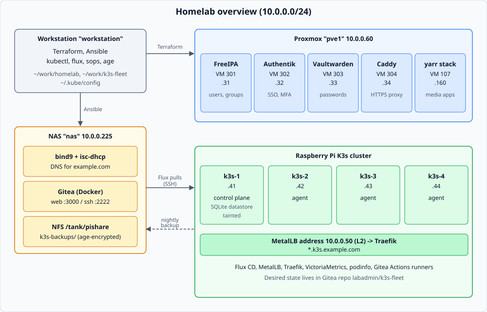

# homelab

Single infrastructure-as-code repo for the lab described in [labplan.md](labplan.md). Terraform builds Proxmox templates and VMs; Ansible configures them.

Current scope: Stage 1 "Foundation" (templates, Ansible, rebuildable test VM), Stage 2 "Identity" (FreeIPA, Authentik, Vaultwarden, Caddy) with SSO in front of the yarr media stack and Gitea, and Stage 3 "Kubernetes" (K3s on four Raspberry Pis, Flux CD from Gitea, SOPS, MetalLB and Traefik ingress, VictoriaMetrics, Gitea Actions runners). Migrated from the former `yarr` repo.

## What runs where



| Service | Host | Notes |
|---------|------|-------|
| FreeIPA | VM 301, 10.0.0.31 | Users, groups, sudo/HBAC. Admin group `lab-admins` |
| Authentik | VM 302, 10.0.0.32 | SSO (`auth.example.com`); FreeIPA is its LDAP source; MFA (TOTP) for everyone |
| Vaultwarden | VM 303, 10.0.0.33 | `vault.example.com`; Authentik SSO as an extra login |
| Caddy | VM 304, 10.0.0.34 | Reverse proxy, Let's Encrypt (GoDaddy DNS-01); Authentik forward auth |
| yarr stack | VM 107, 10.0.0.160 | Plex, Sonarr, Radarr, Prowlarr, qBittorrent (behind Gluetun), FlareSolverr, Homarr, Watchtower |
| Gitea | nas, 10.0.0.225 | `gitea.example.com`; Authentik OIDC login |
| Uptime Kuma | nas, 10.0.0.225:3001 | `uptime.example.com` (Kuma login only, no SSO, so it works while Authentik is down). AutoKuma creates all monitors from `uptime_kuma_monitors` in `group_vars/uptime_kuma_servers/main.yml`; no notifications configured. A timer on yarr pushes Gluetun/Watchtower container health |
| bind9 | nas, 10.0.0.225 | Authoritative DNS for `example.com` (Terraform writes records via RFC 2136) |
| Proxmox | pve1, 10.0.0.60 | Authentik OIDC realm (`sso.tf`) |
| K3s cluster | Pis `k3s-1` to `k3s-4`, 10.0.0.41-44 | One server, three agents. Flux CD syncs the Gitea repo `labadmin/k3s-fleet`. Ingress at `*.k3s.example.com` (10.0.0.50). VictoriaMetrics, podinfo test app. Details and diagrams: [docs/k3s.md](docs/k3s.md) |
| Gitea Actions runners | K3s | `ubuntu-latest` (Docker-in-Docker pods) and `k3s-arm64` (one pod per job) |

SSO coverage:

| App | URL | How it is protected |
|-----|-----|---------------------|
| Sonarr, Radarr, Prowlarr, qBittorrent | `https://<app>.example.com` | Caddy forward auth to Authentik's embedded outpost; app login disabled (`External`); direct ports closed except to Caddy |
| Homarr | `https://homarr.example.com` | Native OIDC; `labadmin` credentials login kept as break-glass |
| Gitea | `https://gitea.example.com` | Native OIDC; `labadmin` local admin kept as break-glass |
| OPNsense | `https://10.0.0.1` | os-sso plugin (OIDC, manual setup in docs/bootstrap.md); only `lab-admins`, mapped to `admins`; local `root` is break-glass |
| Vaultwarden, Proxmox | `vault.` / Proxmox UI | Native OIDC |
| Plex, FlareSolverr, Watchtower, Gluetun | - | Not fronted (Plex authenticates against plex.tv; the rest have no UI) |

Every Authentik user can open the apps. Administrator rights come from the FreeIPA group `lab-admins` (variable `sso_admin_group`).

## Layout

```
terraform/
  modules/proxmox-template/   cloud-image download + template VM
  modules/proxmox-vm/         cloned VM + cloud-init vendor-data snippet
  proxmox/                    root module (local state, gitignored)
    main.tf identity.tf       templates, yarr VM, labtest, identity VMs (301-304)
    dns.tf                    bind9 records: identity hosts, service names (auth, vault, gitea, uptime, sonarr, ...), k3s nodes, *.k3s wildcard
    sso.tf                    Proxmox OIDC realm against Authentik
ansible/
  ansible.cfg  collections/requirements.yml
  inventory/hosts.yml
  inventory/group_vars/{all,yarr,identity,gitea_servers,uptime_kuma_servers,authentik_servers,caddy_servers,vaultwarden_servers,pis,k3s_cluster}/
  inventory/host_vars/
  playbooks/{site,baseline,yarr,identity,gitea,uptime_kuma,ipa_clients,dns,pis,k3s}.yml
  roles/
    common docker nfs_mount                  baseline
    freeipa_server freeipa_client            identity source of truth
    authentik                                SSO + blueprints (homelab, yarr, gitea, opnsense)
    vaultwarden caddy                        passwords, reverse proxy
    internal_dns                             route example.com to the lab DNS server (yarr, nas)
    yarr_stack gitea uptime_kuma             media stack, Gitea (+ their SSO wiring), Uptime Kuma + AutoKuma
    bind9                                    DNS on nas
    k3s k3s_backup flux                      K3s on the Pis, datastore backup, Flux bootstrap
scripts/
  ipa-enroll.sh               enroll hosts in FreeIPA
  vault-add-secret.sh         add a random secret to an ansible-vault file
docs/bootstrap.md             first-time setup, SSO rebuild runbook
docs/k3s.md                   K3s, Flux, ingress, runners, backups (with diagrams)
docs/img/                     SVG diagrams used by the docs
```

`group_vars`/`host_vars` live under `ansible/inventory/` so every playbook loads them without `vars_files`.

## VMID scheme

| Range   | Use                                                                                  |
|---------|--------------------------------------------------------------------------------------|
| 100-199 | Existing/manual VMs. Keep IDs; 106 (Ubuntu template) and 107 (yarr) are Terraform-managed |
| 200-299 | Agent sandboxes                                                                      |
| 301-306 | Core infra: 301 FreeIPA, 302 Authentik, 303 Vaultwarden, 304 Caddy, 305 OPNsense, 306 OpenBao |
| 900-999 | Test/scratch (900 = `labtest`)                                                       |
| 9000+   | New templates (9001 = Debian 13)                                                     |

VM 110 (Jenkins) is managed by a different Terraform config. Never define or import it here.

## State policy

Terraform state is local: `terraform/proxmox/terraform.tfstate`, gitignored. Back it up after every apply. `terraform.tfvars` and `ansible/.vault_pass` are gitignored and hold credentials.

## Day-2 commands

```bash
# Terraform
terraform -chdir=terraform/proxmox init
terraform -chdir=terraform/proxmox plan
terraform -chdir=terraform/proxmox apply

# Ansible (from ansible/)
cd ansible
ansible-galaxy collection install -r collections/requirements.yml
ansible-inventory --graph
ansible-playbook playbooks/yarr.yml --check --diff --skip-tags qbittorrent_password   # dry run
ansible-playbook playbooks/yarr.yml

# Identity, yarr and Gitea (full SSO rebuild order: docs/bootstrap.md)
ansible-playbook playbooks/identity.yml     # FreeIPA, Authentik, Vaultwarden, Caddy
ansible-playbook playbooks/yarr.yml
ansible-playbook playbooks/gitea.yml
ansible-playbook playbooks/uptime_kuma.yml  # Kuma admin + AutoKuma monitors; run after yarr.yml pushes start reporting

# K3s cluster (details: docs/k3s.md)
ansible-playbook playbooks/pis.yml          # Pis: sudo rule, NFS mount, upgrades
ansible-playbook playbooks/k3s.yml          # static IP, K3s, backup timer, kubeconfig, Flux bootstrap
export PATH=~/.local/bin:$PATH; kubectl get nodes -o wide; flux get kustomizations

# New OIDC client secret
scripts/vault-add-secret.sh inventory/group_vars/identity/vault.yml vault_authentik_<app>_client_secret

# Stage 1 rebuild proof: create labtest from the Debian template, configure, destroy
terraform -chdir=terraform/proxmox apply -var labtest_enabled=true
IP=$(terraform -chdir=terraform/proxmox output -raw labtest_ipv4)
(cd ansible && ansible-playbook playbooks/baseline.yml -l labtest -e ansible_host=$IP)
terraform -chdir=terraform/proxmox apply -var labtest_enabled=true -replace='module.labtest_vm[0].proxmox_virtual_environment_vm.vm'
terraform -chdir=terraform/proxmox apply     # labtest_enabled=false destroys it
```

## Known gaps

- Homarr boards, apps and integrations live in `/opt/yarr/config/homarr` and are not rebuilt from code; back that directory up. A brand-new Homarr data directory needs its onboarding user created once.
- Gitea's local `labadmin` password is random on a fresh install; SSO is the normal login (recovery command in docs/bootstrap.md).
- Mobile apps or API clients that reach Sonarr/Radarr/Prowlarr/qBittorrent through the HTTPS names are stopped by forward auth, except each app's `health_path` (`yarr_forward_auth_apps`; Authentik `skip_path_regex`, anchored) which Uptime Kuma uses.

- The Pis are managed from this workstation (`pis.yml`, `k3s.yml`). K3s runs a single server on an SD card; see "Known gaps" in docs/k3s.md.
- Do not run `dns.yml` (or `site.yml`, which imports it) blindly. `roles/bind9/files/db.example.com` is a static zone (serial 5) with only `ns1` and `nas`, while the live zone also holds the records Terraform writes by dynamic update (`allow-update`). `dns.yml --check` shows the zone file would be replaced, and the restart could drop those records. Reconcile the file with the live zone first.
- Legacy history (Google LDAP key, sssd config) remains in git history; revoke the key upstream if still valid.
- The Proxmox API token was previously committed in the yarr repo; rotate it and update only `terraform/proxmox/terraform.tfvars`.
