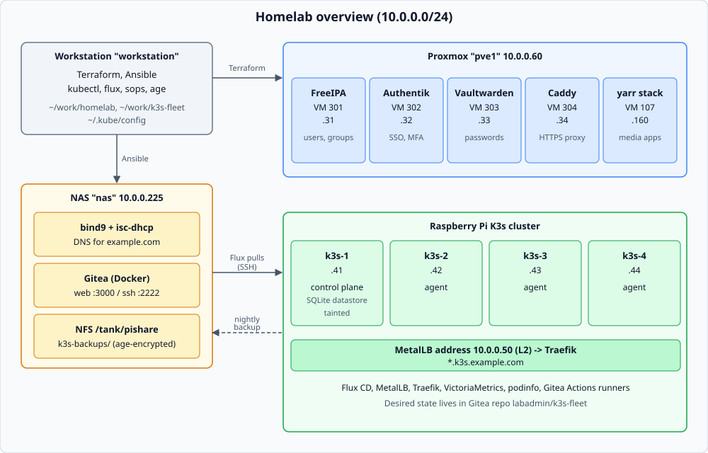
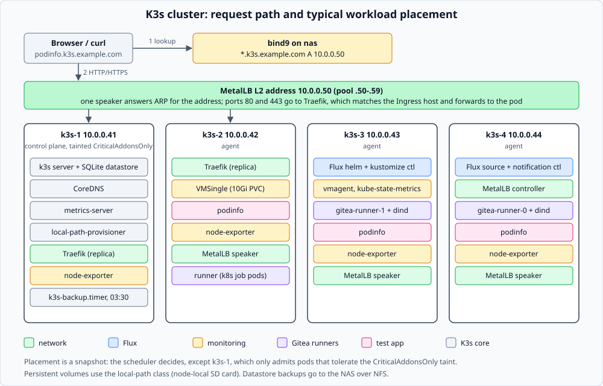
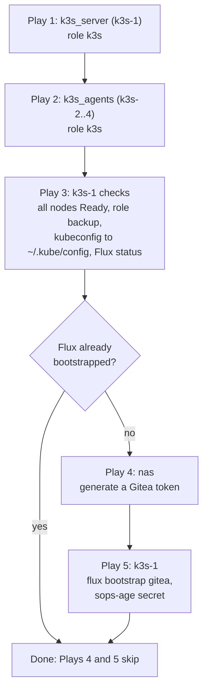
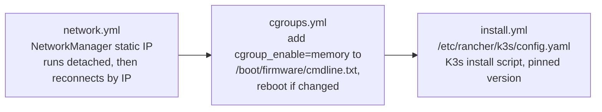
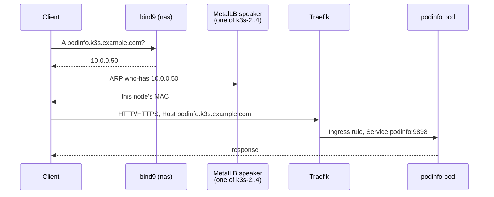
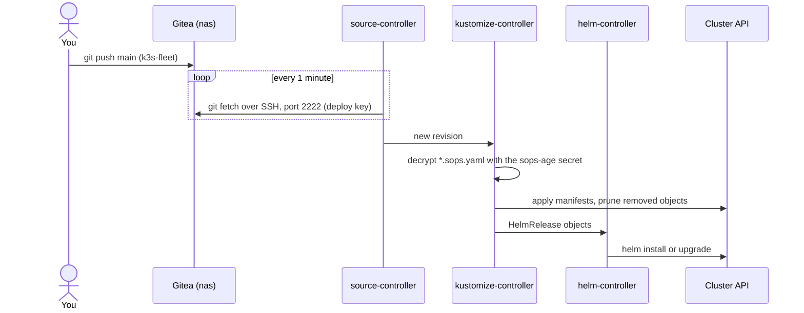
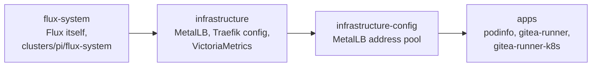
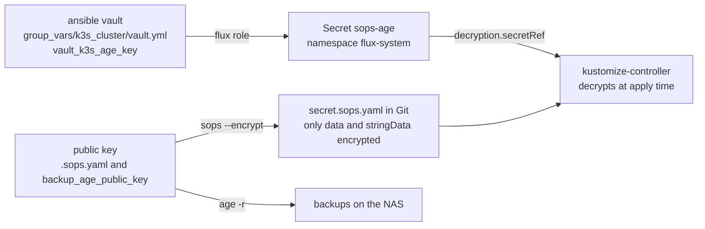
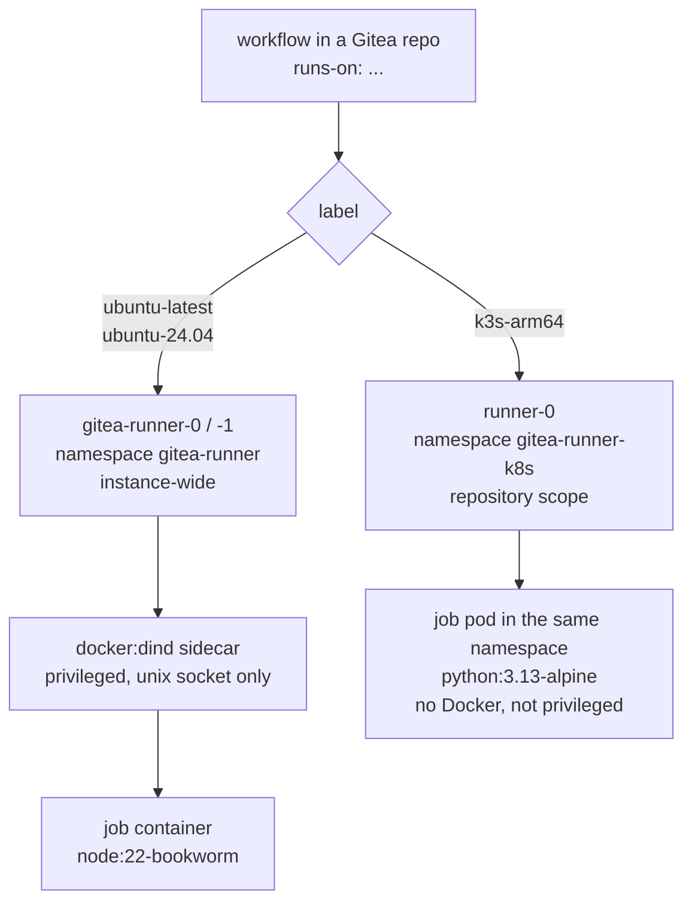
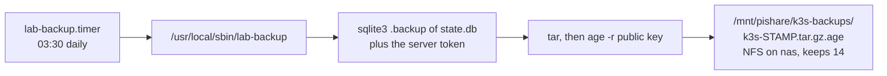

# K3s, Flux and Gitea Actions (Stage 3)

Four Raspberry Pis run K3s. Flux CD deploys everything in the cluster from the Gitea repo `labadmin/k3s-fleet`. A Git commit is the only deployment step.

Other lab services: [services/README.md](services/README.md).



## At a glance

| Piece | What it does | Where it is defined |
|-------|--------------|---------------------|
| K3s `v1.36.5+k3s1` | One server (`k3s-1`, SQLite datastore) and three agents (`k3s-2` to `k3s-4`) | `ansible/roles/k3s`, `ansible/playbooks/k3s.yml` |
| Static addresses | `.41` to `.44`, DNS records in bind9 | `inventory/hosts.yml` (`k3s_node_ip`), `terraform/proxmox/dns.tf` |
| Flux CD `2.10.0` | Pulls `k3s-fleet` from Gitea over SSH and applies it | `ansible/roles/flux`, `k3s-fleet/clusters/pi/` |
| SOPS + age | Encrypted Secrets in Git, decrypted by Flux | `k3s-fleet/.sops.yaml`, vault var `vault_k3s_age_key` |
| MetalLB `0.16.1` | `LoadBalancer` addresses on the LAN (`10.0.0.50` to `.59`, L2) | `k3s-fleet/infrastructure/metallb`, `infrastructure-config` |
| Traefik (K3s built-in) | Ingress for `*.k3s.example.com` | `k3s-fleet/infrastructure/traefik` |
| VictoriaMetrics k8s-stack `0.97.0` | Metrics, 30 day retention, no Grafana, no alerting | `k3s-fleet/infrastructure/monitoring` |
| podinfo `6.17.0` | Test application (SOPS secret, 3 replicas, ingress) | `k3s-fleet/apps/podinfo` |
| Gitea Actions runners | Two runners, see [Gitea Actions runners](#gitea-actions-runners) | `k3s-fleet/apps/gitea-runner*` |
| Datastore backup | Nightly, age-encrypted, to the NAS | `ansible/roles/backup` |

Two repos hold the work:

| Repo | Holds | Changed with |
|------|-------|--------------|
| `homelab` (this repo, private) | Machines: OS settings, K3s install, Flux bootstrap, DNS, backups | `ansible-playbook`, `terraform apply` |
| `labadmin/k3s-fleet` (Gitea, private) | Everything that runs inside the cluster | `git push`, then Flux applies it |

## Cluster layout



`k3s-1` is tainted `CriticalAddonsOnly=true:NoExecute`. It runs the K3s server and the add-ons that tolerate the taint, and nothing else, to spare its SD card. Each pod can land on a different node after a restart; the picture is a snapshot.

## Building it with Ansible

`playbooks/k3s.yml` does everything on the machines. It is idempotent: a second run reports `changed=0`.



Role `k3s` runs three task files per node:



Why each step exists:

- **Static IP.** `nmcli` switches `Wired connection 1` to the fixed address and drops the DHCP lease. The command runs with `async` so the SSH session can die, then the play sets `ansible_host` to the IP and waits for the host. Terraform writes the matching DNS records, because DHCP no longer updates them.
- **Memory cgroup.** Raspberry Pi OS boots with `cgroup_disable=memory`. K3s will not run pods without it, so the later `cgroup_enable=memory` parameter overrides it (one reboot).
- **Pod DNS.** `/etc/rancher/k3s/resolv.conf` lists only nas (`10.0.0.225`). CoreDNS forwards to it, so pods resolve split-horizon names such as `gitea.example.com`. The router and `8.8.8.8` answer NXDOMAIN for those.
- **ServiceLB off.** The server config sets `disable: [servicelb]`; MetalLB replaces it.

First-time sudo on `k3s-1`: the `pis.yml` pre-task installs `/etc/sudoers.d/labadmin` (NOPASSWD). On a freshly imaged Pi the first run needs `-e ansible_become_pass=...` (use a temporary 0600 vars file, never the command line).

## Networking and ingress

Addresses:

| Name | Address | Managed by |
|------|---------|------------|
| `k3s-1` to `k3s-4` | `10.0.0.41` to `.44` | Ansible (NetworkManager) and Terraform (`dns_a_record_set.k3s_node`) |
| `*.k3s.example.com` | `10.0.0.50` | Terraform (`dns_a_record_set.k3s_ingress_wildcard`) |
| MetalLB pool | `10.0.0.50` to `.59` | `infrastructure-config/metallb-pool.yaml` |

The DHCP range on nas is `.100` to `.200`, so none of these collide with leases.

How a request reaches a pod:



To publish an app, add an `Ingress` with `ingressClassName: traefik` and a host under `k3s.example.com`. A `Service` of `type: LoadBalancer` takes its own address from the pool. Port 443 serves Traefik's self-signed certificate; trusted certificates are not set up (Caddy holds the lab's Let's Encrypt certificates and does not front `*.k3s`).

## GitOps flow



Flux objects, in the order they reconcile:



`infrastructure-config` is separate because the pool uses MetalLB custom resources, which only exist after the MetalLB chart installs. `apps` waits for all of it, so apps never start without an address pool.

`k3s-fleet` layout:

```
clusters/pi/
  flux-system/                  written by flux bootstrap; do not edit by hand
  infrastructure.yaml           Flux Kustomization -> ./infrastructure
  infrastructure-config.yaml    Flux Kustomization -> ./infrastructure-config (dependsOn infrastructure)
  apps.yaml                     Flux Kustomization -> ./apps (dependsOn infrastructure-config)
infrastructure/
  metallb/  traefik/  monitoring/
infrastructure-config/          metallb-pool.yaml
apps/
  podinfo/  gitea-runner/  gitea-runner-k8s/
.sops.yaml                      encryption rule for *.sops.yaml
```

Working on it:

```bash
git -C ~/work/k3s-fleet pull
# edit, commit, push
flux reconcile kustomization flux-system --with-source   # optional: skip the 1 minute wait
flux get kustomizations
flux get helmreleases -A
flux logs --follow
```

Proof that a commit deploys: changing `replicas: 2` to `3` in `apps/podinfo/deployment.yaml` and pushing produced 3 ready pods within 2 minutes with no cluster access.

## Secrets (SOPS and age)

One age key does two jobs. Its public half encrypts Secrets in `k3s-fleet` and the K3s datastore backups. The private half lives in the Ansible vault.



Add a secret:

```bash
cd ~/work/k3s-fleet
cat > apps/myapp/secret.sops.yaml <<'EOF'
apiVersion: v1
kind: Secret
metadata: {name: myapp, namespace: myapp}
stringData: {password: change-me}
EOF
sops --encrypt --in-place apps/myapp/secret.sops.yaml     # uses .sops.yaml, needs no private key
grep -c 'ENC\[' apps/myapp/secret.sops.yaml               # must be >= 1
```

The file name must end in `.sops.yaml` or the rule does not match. Edit or read an existing one with the private key (never print it):

```bash
cd ~/work/homelab/ansible
export SOPS_AGE_KEY=$(ansible-vault view inventory/group_vars/k3s_cluster/vault.yml | sed -n 's/^vault_k3s_age_key: *//p' | tr -d '"')
sops ~/work/k3s-fleet/apps/podinfo/secret.sops.yaml
```

Keep a second copy of the age key in Vaultwarden. If it is lost, the encrypted backups cannot be read and every `*.sops.yaml` must be re-encrypted with a new key.

## Monitoring

`vm-stack` (VictoriaMetrics operator chart) runs in the `monitoring` namespace: `vmagent` scrapes node-exporter, kube-state-metrics, the kubelets (cAdvisor), the API server and CoreDNS, and `vmsingle` stores the data (30 days, 10 Gi `local-path` volume). Grafana, Alertmanager, vmalert, default dashboards and rules are off. The K3s control plane components (controller manager, scheduler) are not scraped: they sit inside the K3s server process, and there is no etcd.

```bash
kubectl -n monitoring port-forward svc/vmsingle-vm 8428:8428
# UI:  http://localhost:8428/vmui
curl -s 'localhost:8428/api/v1/query?query=count(node_uname_info)' | jq -r '.data.result[0].value[1]'   # 4
```

## Gitea Actions runners

Two runners exist, and a workflow picks one by its `runs-on` label.



| | `gitea-runner` | `gitea-runner-k8s` |
|---|---|---|
| Replicas | 2 (StatefulSet) | 1 |
| Image | `gitea/act_runner:0.6.1` + `docker:28.5.2-dind` | `gitea/runner:5.2.4` |
| Labels | `ubuntu-latest`, `ubuntu-24.04` (both `node:22-bookworm`) | `k3s-arm64` (`python:3.13.18-alpine3.23`) |
| Registered for | The whole Gitea instance | One repository |
| Job isolation | Containers inside a privileged dind sidecar | One pod per job, RBAC limited to its own namespace |
| Use for | General CI, anything that needs `docker` | Jobs that handle credentials; the `publish` workflow of this repo |

Both are arm64 only: images that ship only for amd64 will not run. Both keep `.runner` on a 1 Gi `local-path` volume, so a restarted pod keeps its registration and does not appear twice in Gitea.

Use it from any repo (Actions is on by default in Gitea 1.27):

```yaml
# .gitea/workflows/ci.yaml
on: [push]
jobs:
  test:
    runs-on: ubuntu-latest
    steps:
      - uses: actions/checkout@v4
      - run: uname -m && echo hello
```

The registration token is a Secret in `k3s-fleet` (SOPS-encrypted) and is only used the first time a pod starts. Rotate it only to add replicas or after deleting a runner's volume: `docker exec -u git gitea gitea actions generate-runner-token` on nas, put it in the `secret.sops.yaml` of that runner, push.

The `publish` workflow (`.gitea/workflows/publish.yml`) mirrors this repo to GitHub with secrets stripped (`publish/sanitize.py`, then `gitleaks`). Keep new documentation free of credentials and anything the rules in `publish/rules.toml` would flag.

## Datastore backup



The share is world-readable, so every archive is encrypted. State and token go together because a restore needs both. Run one now and check it:

```bash
ssh labadmin@k3s-1.example.com 'sudo systemctl start lab-backup.service && ls -1t /mnt/pishare/k3s-backups | head -3'
```

Restore (decrypting and listing an archive has been tested; a full restore has not been rehearsed):

```bash
# on a workstation with the private key in /tmp/k.age (mode 0600)
age -d -i /tmp/k.age /path/to/k3s-STAMP.tar.gz.age | tar -xzf - -C /tmp/restore     # state.db, token
# on k3s-1
sudo systemctl stop k3s
sudo rm -f /var/lib/rancher/k3s/server/db/state.db*
sudo cp /tmp/restore/state.db /var/lib/rancher/k3s/server/db/state.db
sudo cp /tmp/restore/token /var/lib/rancher/k3s/server/token
sudo systemctl start k3s
```

If `k3s-1` is lost entirely, a rebuild is faster than a restore (see below): Flux recreates everything from Git. Restore only matters for state that is not in Git, such as `local-path` volumes (which are not covered by this backup).

## Day-2 commands

```bash
export PATH=~/.local/bin:$PATH            # kubectl, flux, sops, age live here
kubectl get nodes -o wide
kubectl get pods -A
flux get all -A

# Reach things that have no ingress
kubectl -n podinfo port-forward svc/podinfo 9898:9898
kubectl -n monitoring port-forward svc/vmsingle-vm 8428:8428
```

| Task | How |
|------|-----|
| Deploy or change an app | Edit `k3s-fleet`, `git push`. |
| Add an app | New directory under `apps/`, list it in `apps/kustomization.yaml`. |
| Roll back | `git revert` the commit and push. |
| Pause Flux for a change | `flux suspend kustomization apps`, later `flux resume kustomization apps`. |
| Upgrade K3s | Change `k3s_version` in `group_vars/k3s_cluster/main.yml`, run `playbooks/k3s.yml`. The install script re-runs when the version differs. |
| Upgrade Flux | Install the newer CLI, run `flux bootstrap gitea` again with the flags in `roles/flux/tasks/main.yml` (the playbook only bootstraps once). Not rehearsed. |
| Add a node | Add it to `inventory/hosts.yml` (`k3s_node_ip`, group `k3s_agents`) and a record in `dns.tf`, then `terraform apply`, `playbooks/pis.yml`, `playbooks/k3s.yml`. |
| SSH to a node | `ssh labadmin@k3s-1.example.com`; on the server `sudo k3s kubectl ...` also works. |

Rebuilding the whole cluster from scratch, from `ansible/`:

```bash
terraform -chdir=../terraform/proxmox apply     # DNS records
ansible-playbook playbooks/pis.yml              # sudo rule, NFS mount, upgrades
ansible-playbook playbooks/k3s.yml              # network, cgroup, K3s, backup, Flux bootstrap
```

Flux bootstraps again against the existing `k3s-fleet` repo and syncs it, so all workloads should return (a full rebuild has not been rehearsed). The `sops-age` secret is recreated from the vault. Data in `local-path` volumes (VictoriaMetrics history, runner registrations) is lost; runners re-register from their SOPS token.

## Troubleshooting

| Symptom | Cause and fix |
|---------|---------------|
| `ansible pis -m ping` says no route to host right after an IP change | The workstation caches the old DHCP record (TTL 3600). Wait, or flush the resolver, or use the IP once. Terraform must also have removed the old A record (a second `apply` does it). |
| `terraform plan` shows `k3s_node` changes after the first apply | Old DDNS records remain in the same record set. Apply again. |
| K3s fails to start after a reboot or reimage | Check the memory cgroup first. `cat /sys/fs/cgroup/cgroup.controllers` must list `memory`; check `/boot/firmware/cmdline.txt`. |
| Traefik service stuck at `<pending>` | MetalLB not ready or the pool is missing: `kubectl -n metallb-system get pods`, `kubectl get ipaddresspool -A`, `flux get kustomizations`. |
| Ingress returns 404 | Traefik log says `service port not found`: the Ingress refers to a named port the Service does not define. Use the port number (podinfo's Service port has no name). |
| A Flux Kustomization is stuck `dependency ... is not ready` | Fix the upstream one first (`flux get kustomizations`, `flux logs`). |
| HelmRelease times out on first install | Image pulls on the Pis are slow. `flux reconcile helmrelease <name> -n <ns>`; 3 retries are configured. |
| The bundled `act_runner:*-dind` image never starts the runner | Its readiness check gives up after about 7 seconds and dockerd needs about 8 on these Pis. The deployed runner uses a separate dind sidecar for that reason; do not switch back. |
| Pod cannot resolve `gitea.example.com` | Pod DNS must go to nas: check `/etc/rancher/k3s/resolv.conf` on the node and restart K3s. |

## Known gaps

- Single control plane on an SD card. Losing `k3s-1` stops the API (workloads keep running) until it is rebuilt or restored. Three control planes with embedded etcd and SSDs come later.
- `local-path` volumes are node-local and not backed up. Only the K3s datastore is.
- No trusted TLS for `*.k3s.example.com` yet.
- The dind runners are privileged, and any repo can use them.
- The access token used by `flux bootstrap` stays in Gitea (named `flux-bootstrap-<timestamp>` in labadmin's settings). Flux's deploy key was created with it, so check that Flux still syncs before revoking it.
