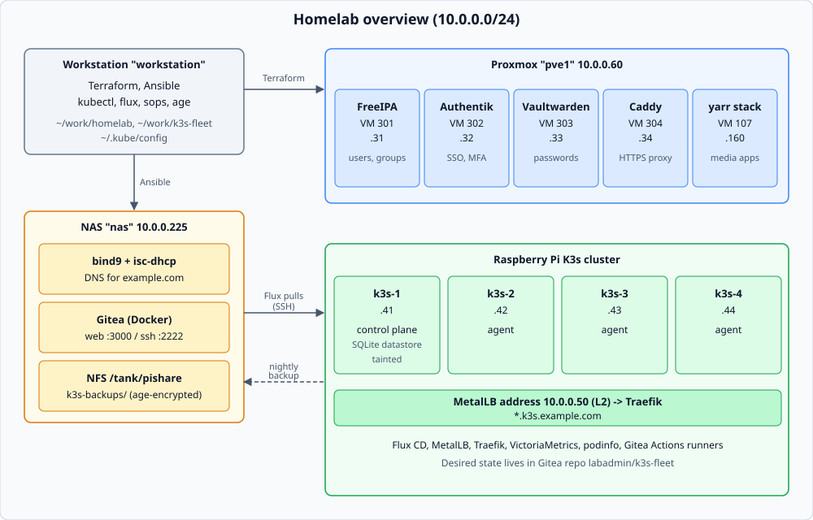
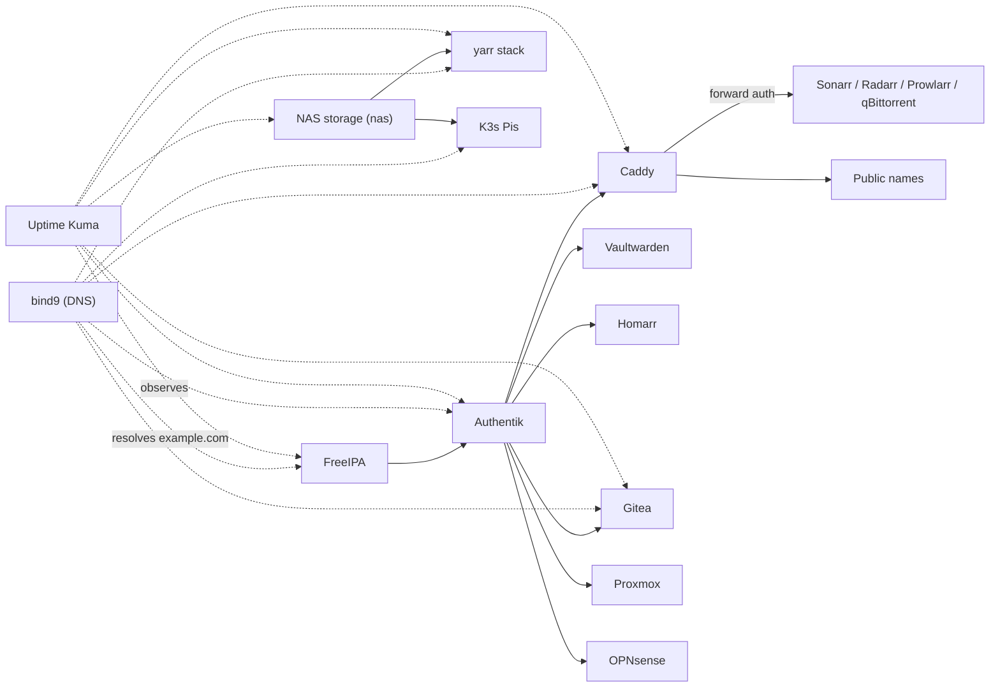

# Services

One doc per lab service. Each follows the same template: **Purpose** (what the service is for), **Configuration** (files, variables, secrets), **How it works**, and **Operations** (deploy, verify, recover, known gaps). The ordered whole-lab bootstrap is in [../bootstrap.md](../bootstrap.md).

| Group | Service | Host | Doc | Purpose |
|---|---|---|---|---|
| Platform | Proxmox and Terraform | pve1, 10.0.0.60 | [proxmox.md](proxmox.md) | Hypervisor, templates, VMs, Proxmox OIDC realm |
| Platform | Host baseline roles | all managed hosts | [host-baseline.md](host-baseline.md) | `common`, `docker`, `nfs_mount`, `internal_dns` roles shared by every host |
| Platform | bind9 | nas, 10.0.0.225 | [bind9.md](bind9.md) | Authoritative DNS for `example.com`; Terraform writes records over RFC 2136 |
| Identity & edge | FreeIPA | VM 301, 10.0.0.31 | [freeipa.md](freeipa.md) | Users, groups, HBAC and sudo policy; enrolls lab hosts |
| Identity & edge | Authentik | VM 302, 10.0.0.32 | [authentik.md](authentik.md) | SSO and MFA, with FreeIPA as LDAP source and blueprints for every OIDC/proxy app |
| Identity & edge | Vaultwarden | VM 303, 10.0.0.33 | [vaultwarden.md](vaultwarden.md) | Password manager with Authentik SSO as an extra login |
| Identity & edge | Caddy | VM 304, 10.0.0.34 | [caddy.md](caddy.md) | Reverse proxy, Let's Encrypt via GoDaddy DNS-01, Authentik forward auth |
| Identity & edge | OPNsense WebGUI SSO | router, 10.0.0.1 | [opnsense-sso.md](opnsense-sso.md) | Router login through Authentik (manual router-side setup) |
| NAS (nas) | NAS storage | nas, 10.0.0.225 | [nas-storage.md](nas-storage.md) | ZFS pool, NFS and Samba shares used by yarr and the Pis (not managed here) |
| NAS (nas) | Gitea | nas, 10.0.0.225 | [gitea.md](gitea.md) | Git hosting with Authentik OIDC; source for Flux |
| NAS (nas) | Uptime Kuma | nas, 10.0.0.225:3001 | [uptime-kuma.md](uptime-kuma.md) | Up/down checks for every lab service, monitors created by AutoKuma |
| Media (yarr) | yarr stack | VM 107, 10.0.0.160 | [yarr-stack.md](yarr-stack.md) | Compose project, storage, firewall and secrets for the media containers; FlareSolverr and Watchtower |
| Media (yarr) | Sonarr, Radarr, Prowlarr | VM 107 | [arr-apps.md](arr-apps.md) | TV, movie and indexer management behind forward auth |
| Media (yarr) | qBittorrent and Gluetun | VM 107 | [qbittorrent-gluetun.md](qbittorrent-gluetun.md) | Torrent client whose traffic leaves through a ProtonVPN WireGuard tunnel |
| Media (yarr) | Plex | VM 107 | [plex.md](plex.md) | Media server with hardware transcoding |
| Media (yarr) | Homarr | VM 107 | [homarr.md](homarr.md) | Dashboard with native Authentik OIDC login |
| Kubernetes | K3s cluster (K3s, Flux, MetalLB, Traefik, SOPS, VictoriaMetrics, podinfo, Gitea Actions runners, datastore backup) | k3s-1..4 | [../k3s.md](../k3s.md) | Four-Pi cluster synced from Gitea by Flux CD |

## Dependencies

## Not documented

Other containers on nas, and the `server1` inventory entry, are not managed by this repo and have no doc.
