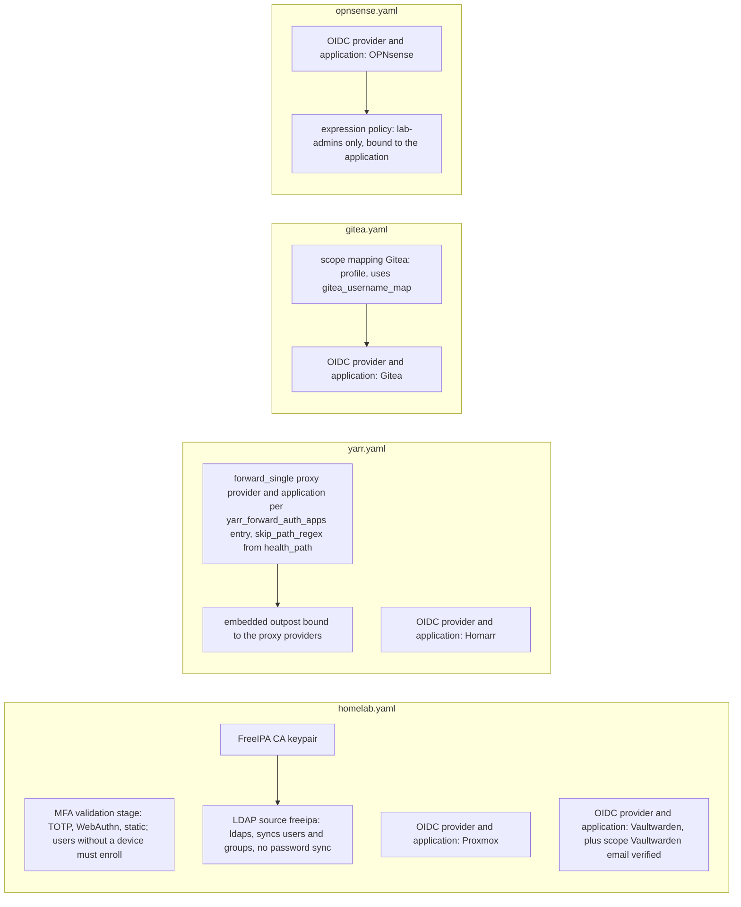
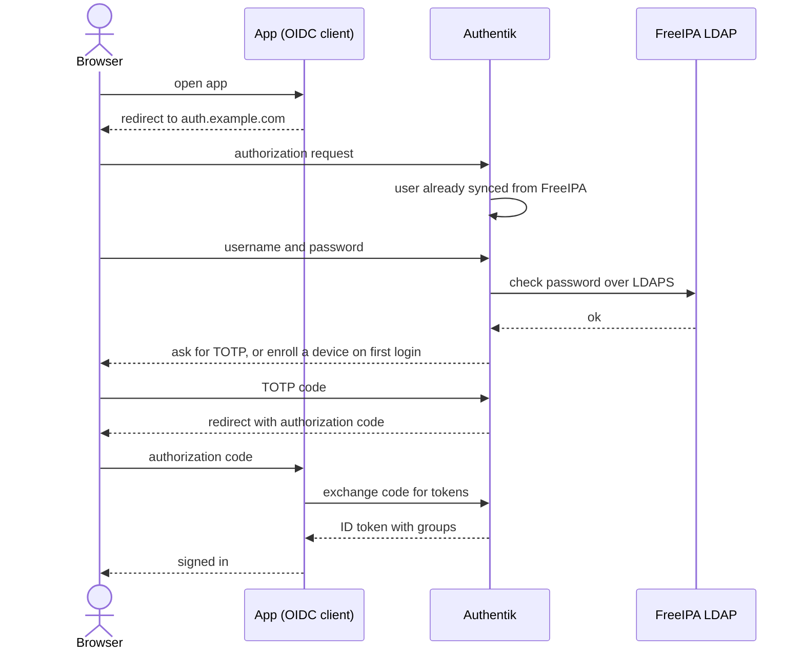

# Authentik

Authentik is the lab's single sign-on service: it reads users from [FreeIPA](freeipa.md), enforces MFA, and signs people in to every protected app through OIDC or Caddy forward auth.

| | |
|---|---|
| Host | VM 302 `authentik` (Debian, 2 cores, 6144 MB, 32 GB), 10.0.0.32 |
| Address / URL | `http://10.0.0.32:9000` (direct), `https://auth.example.com` (through [Caddy](caddy.md)) |
| Ports | 9000 published by the `server` container; firewall (UFW) opens 22 and 9000 |
| Software | `ghcr.io/goauthentik/server:2026.8.5` (`server` and `worker`), `docker.io/library/postgres:16-alpine` |
| Data | `/opt/authentik` (`data`, `certs`, `custom-templates`, `blueprints`, `.env`, `docker-compose.yml`); PostgreSQL in the Docker named volume `database` |
| Deployed by | `playbooks/identity.yml`, roles `common`, `docker`, `freeipa_client`, `authentik` |
| Depends on | [FreeIPA](freeipa.md) (LDAP source, CA certificate), [bind9](bind9.md) (DNS), [Caddy](caddy.md) (public TLS name), [host-baseline](host-baseline.md) |
| Used by | [Caddy](caddy.md) (forward auth), [Vaultwarden](vaultwarden.md), [Homarr](homarr.md), [Gitea](gitea.md), [Proxmox](proxmox.md), [OPNsense](opnsense-sso.md), [Sonarr, Radarr, Prowlarr](arr-apps.md) and [qBittorrent](qbittorrent-gluetun.md) (forward auth) |

## Purpose

Authentik gives every lab user one login. It imports users and groups from FreeIPA over LDAPS, makes everyone enroll a second factor (TOTP, WebAuthn or static codes), and then acts as an OIDC identity provider for Proxmox, Vaultwarden, Homarr, Gitea and OPNsense, and as a forward-auth proxy provider for the yarr web UIs that have no login of their own. The admin group is the FreeIPA group `lab-admins` (variable `sso_admin_group`).

Everything is declared as code: no UI step is needed after a rebuild. The role renders four blueprints that Authentik applies itself.

## Configuration

### Files

| Path | What it sets |
|------|--------------|
| [`ansible/roles/authentik/tasks/main.yml`](../../ansible/roles/authentik/tasks/main.yml) | Directories, FreeIPA CA copy, `.env`, compose file, the four blueprints, start, and the readiness waits |
| [`ansible/roles/authentik/defaults/main.yml`](../../ansible/roles/authentik/defaults/main.yml) | `authentik_dir`, `authentik_tag` |
| [`ansible/roles/authentik/templates/docker-compose.yml.j2`](../../ansible/roles/authentik/templates/docker-compose.yml.j2) | Compose project `authentik`: `postgresql`, `server`, `worker` |
| [`ansible/roles/authentik/templates/env.j2`](../../ansible/roles/authentik/templates/env.j2) | `/opt/authentik/.env` (mode 0600): secrets and the image tag |
| [`ansible/roles/authentik/templates/blueprints/homelab.yaml.j2`](../../ansible/roles/authentik/templates/blueprints/homelab.yaml.j2) | MFA stage, FreeIPA CA keypair and LDAP source, Proxmox and Vaultwarden providers and applications |
| [`ansible/roles/authentik/templates/blueprints/yarr.yaml.j2`](../../ansible/roles/authentik/templates/blueprints/yarr.yaml.j2) | Forward-auth proxy providers, Homarr OIDC provider, embedded outpost |
| [`ansible/roles/authentik/templates/blueprints/gitea.yaml.j2`](../../ansible/roles/authentik/templates/blueprints/gitea.yaml.j2) | Gitea OIDC provider and the "Gitea: profile" scope mapping |
| [`ansible/roles/authentik/templates/blueprints/opnsense.yaml.j2`](../../ansible/roles/authentik/templates/blueprints/opnsense.yaml.j2) | OPNsense OIDC provider, application, and the `lab-admins`-only policy |
| [`ansible/inventory/group_vars/authentik_servers/main.yml`](../../ansible/inventory/group_vars/authentik_servers/main.yml) | `firewall_allowed_tcp_ports` (22, 9000) |
| [`ansible/inventory/group_vars/identity/main.yml`](../../ansible/inventory/group_vars/identity/main.yml) | `authentik_fqdn`, `authentik_http_port`, `vaultwarden_fqdn`, `ipa_base_dn` |
| [`ansible/inventory/group_vars/all/main.yml`](../../ansible/inventory/group_vars/all/main.yml) | `yarr_forward_auth_apps`, `homarr_fqdn`, `gitea_fqdn`, `gitea_username_map`, `opnsense_gui_url`, `sso_admin_group` and the FreeIPA names |

### Variables

| Variable | Defined in | Value / meaning |
|----------|------------|-----------------|
| `authentik_dir` | `roles/authentik/defaults/main.yml` | `/opt/authentik` |
| `authentik_tag` | `roles/authentik/defaults/main.yml` | `2026.8.5`, written to `.env` as `AUTHENTIK_TAG` |
| `authentik_fqdn` | `group_vars/all/main.yml`, `group_vars/identity/main.yml` | `auth.example.com` (outpost host and OIDC issuer host) |
| `authentik_http_port` | `group_vars/identity/main.yml` | `9000` |
| `vaultwarden_fqdn` | `group_vars/identity/main.yml` | `vault.example.com`, used in the Vaultwarden redirect URI |
| `homarr_fqdn` | `group_vars/all/main.yml` | `homarr.example.com`, used in the Homarr redirect URI |
| `gitea_fqdn`, `gitea_oauth_source_name` | `group_vars/all/main.yml` | `gitea.example.com`, `authentik`; build the Gitea redirect URI `/user/oauth2/authentik/callback` |
| `opnsense_gui_url` | `group_vars/all/main.yml` | `https://10.0.0.1`; base of the OPNsense redirect URIs |
| `yarr_forward_auth_apps` | `group_vars/all/main.yml` | One entry (`slug`, `name`, `fqdn`, `port_var`, `health_path`) per forward-auth app: Sonarr, Radarr, Prowlarr, qBittorrent. Each becomes a proxy provider and an application; `health_path` becomes the `skip_path_regex` |
| `gitea_username_map` | `group_vars/all/main.yml` | Authentik username to local Gitea username (`labuser: labadmin`); used by the "Gitea: profile" scope |
| `sso_admin_group` | `group_vars/all/main.yml` | `lab-admins`; the only group allowed into OPNsense |
| `ipa_server_fqdn`, `ipa_base_dn` | `group_vars/all`, `group_vars/identity` | LDAP source URI (`ldaps://freeipa.example.com`) and base DN |

### Secrets

All in `ansible/inventory/group_vars/identity/vault.yml`. The role renders them into `/opt/authentik/.env` (`env.j2`); the blueprints read them with `!Env`.

| Vault variable | Vault file | Used for |
|----------------|------------|----------|
| `vault_authentik_secret_key` | `group_vars/identity/vault.yml` | `AUTHENTIK_SECRET_KEY` |
| `vault_authentik_pg_password` | `group_vars/identity/vault.yml` | `PG_PASS` (PostgreSQL password) |
| `vault_authentik_bootstrap_password` | `group_vars/identity/vault.yml` | `AUTHENTIK_BOOTSTRAP_PASSWORD` (initial admin password) |
| `vault_authentik_bootstrap_token` | `group_vars/identity/vault.yml` | `AUTHENTIK_BOOTSTRAP_TOKEN`; the role also uses it as the Bearer token when it polls the API |
| `vault_authentik_proxmox_client_secret` | `group_vars/identity/vault.yml` | `AUTHENTIK_PROXMOX_CLIENT_SECRET`, OIDC client `proxmox`. Must equal `proxmox_oidc_client_secret` in `terraform.tfvars` ([proxmox](proxmox.md)) |
| `vault_authentik_vaultwarden_client_secret` | `group_vars/identity/vault.yml` | `AUTHENTIK_VAULTWARDEN_CLIENT_SECRET`, OIDC client `vaultwarden` ([vaultwarden](vaultwarden.md)) |
| `vault_authentik_homarr_client_secret` | `group_vars/identity/vault.yml` | `AUTHENTIK_HOMARR_CLIENT_SECRET`, OIDC client `homarr` ([homarr](homarr.md)) |
| `vault_authentik_gitea_client_secret` | `group_vars/identity/vault.yml` | `AUTHENTIK_GITEA_CLIENT_SECRET`, OIDC client `gitea` ([gitea](gitea.md)) |
| `vault_authentik_opnsense_client_secret` | `group_vars/identity/vault.yml` | `AUTHENTIK_OPNSENSE_CLIENT_SECRET`, OIDC client `opnsense` ([opnsense-sso](opnsense-sso.md)) |
| `vault_ipa_authentik_bind_password` | `group_vars/identity/vault.yml` | `AUTHENTIK_FREEIPA_BIND_PASSWORD`, the password of the `uid=authentik` LDAP bind account ([freeipa](freeipa.md)) |

A new random OIDC client secret is added with `scripts/vault-add-secret.sh` (it refuses to overwrite an existing variable); see [Rebuilding SSO](#rebuilding-sso).

## How it works

**Stack.** The compose project `authentik` in `/opt/authentik` runs three containers:

- `postgresql` (`postgres:16-alpine`, named volume `database`, with a `pg_isready` health check).
- `server` (publishes `9000`, mounts `./data` and `./custom-templates`), started after PostgreSQL is healthy.
- `worker` (runs as root, mounts `/var/run/docker.sock`, `./data`, `./certs`, `./custom-templates` and `./blueprints` read-only at `/blueprints/custom`).

**Role order.** The role creates the directories, then copies the FreeIPA CA certificate from `/etc/ipa/ca.crt` on the FreeIPA server into `blueprints/freeipa-ca.crt`. It renders `.env`, the compose file and the four blueprints, and starts the project. It then waits for `/-/health/ready/` on `127.0.0.1:9000`, and polls the API with the bootstrap token until:

- the LDAP source `freeipa` exists (the `homelab` blueprint has applied),
- the first user from `ipa_users` has been synced from FreeIPA (the role polls the API because `ak ldap_sync` blocks on a result that is never stored),
- the applications `homarr`, `gitea` and `opnsense` exist (the `yarr`, `gitea` and `opnsense` blueprints have applied).

**Blueprints.** The four rendered blueprints create these objects:



- **`homelab`:** MFA for everyone (a `device_classes: [totp, webauthn, static]` validation stage with `not_configured_action: configure`, so users without a device must enroll at next login). The FreeIPA CA keypair and the LDAP source `freeipa` (`ldaps://freeipa.example.com`, bind as `uid=authentik,cn=sysaccounts,cn=etc,dc=example,dc=com`, syncs users from `cn=users,cn=accounts` and groups from `cn=groups,cn=accounts`; `sync_users_password: false`, so passwords stay in FreeIPA). OIDC providers for Proxmox and Vaultwarden. Authentik's stock email scope reports `email_verified=false`, which Vaultwarden refuses, so the blueprint adds the scope mapping "Vaultwarden: email (verified)" that vouches for the FreeIPA-managed address. The Vaultwarden provider also sets `access_token_validity: hours=1`, because Vaultwarden's web client treats tokens shorter than about five minutes as expired.
- **`yarr`:** a `forward_single` proxy provider and an application per `yarr_forward_auth_apps` entry, each with `skip_path_regex "^<health_path>$"` so that only that path is reachable without login (it lets [Uptime Kuma](uptime-kuma.md) probe the apps). The Homarr OIDC provider, and the embedded outpost, bound to the proxy providers.
- **`gitea`:** the "Gitea: profile" scope mapping, which looks the Authentik username up in `gitea_username_map` and returns it as `nickname` and `preferred_username` (plus the user's group names in `groups`); and the Gitea OIDC provider.
- **`opnsense`:** the OIDC provider (authorization-code grant only, signed with the self-signed RS256 certificate) and an expression policy that allows only `lab-admins`. It is an expression policy rather than a group binding, because the FreeIPA group exists only after the first LDAP sync.

**An OIDC login:**



For forward-auth apps the same login happens through Caddy instead of an OIDC client; see [caddy](caddy.md).

### SSO coverage

| App | URL | How it is protected |
|-----|-----|---------------------|
| Sonarr, Radarr, Prowlarr, qBittorrent | `https://<app>.example.com` | Caddy forward auth to Authentik's embedded outpost; app login disabled (`External`); direct ports closed except to Caddy ([arr-apps](arr-apps.md), [qbittorrent-gluetun](qbittorrent-gluetun.md)) |
| Homarr | `https://homarr.example.com` | Native OIDC; `labadmin` credentials login kept as break-glass ([homarr](homarr.md)) |
| Gitea | `https://gitea.example.com` | Native OIDC; `labadmin` local admin kept as break-glass ([gitea](gitea.md)) |
| OPNsense | `https://10.0.0.1` | os-sso plugin (OIDC, manual setup in [opnsense-sso](opnsense-sso.md)); only `lab-admins`, mapped to `admins`; local `root` is break-glass |
| Vaultwarden, Proxmox | `vault.` / Proxmox UI | Native OIDC ([vaultwarden](vaultwarden.md), [proxmox](proxmox.md)) |
| Plex, FlareSolverr, Watchtower, Gluetun | - | Not fronted (Plex authenticates against plex.tv; the rest have no UI) ([plex](plex.md), [yarr-stack](yarr-stack.md), [qbittorrent-gluetun](qbittorrent-gluetun.md)) |

Every Authentik user can open the apps. Administrator rights come from the FreeIPA group `lab-admins` (variable `sso_admin_group`).

## Operations

Deploy (from `ansible/`):

```bash
ansible-playbook playbooks/identity.yml     # FreeIPA, Authentik, Vaultwarden, Caddy
```

Verify: the role itself waits for the API checks listed above. Uptime Kuma checks `http://10.0.0.32:9000/-/health/ready/` and `https://auth.example.com/-/health/live/` ([uptime-kuma](uptime-kuma.md)).

### Rebuilding SSO

(Authentik, Caddy, yarr apps, Homarr, Gitea.) Everything is declarative; no UI step is needed after a rebuild.

1. Secrets. A new OIDC client needs a secret in `ansible/inventory/group_vars/identity/vault.yml`: `scripts/vault-add-secret.sh inventory/group_vars/identity/vault.yml vault_authentik_<app>_client_secret` (refuses to overwrite).
2. DNS: `terraform -chdir=terraform/proxmox apply` (`dns_a_record_set.service` holds `auth`, `sonarr`, `radarr`, `prowlarr`, `qbittorrent`, `homarr`, `gitea`, all pointing at Caddy).
3. In order, from `ansible/`:
   ```bash
   ansible-playbook playbooks/identity.yml     # FreeIPA, Authentik blueprints (homelab, yarr, gitea, opnsense), Caddy
   ansible-playbook playbooks/yarr.yml         # internal DNS, apps with External auth, SSO firewall, Homarr OIDC + admin group
   ansible-playbook playbooks/gitea.yml        # internal DNS, Gitea admin, ROOT_URL, Authentik OIDC source
   ```
   Caddy's first start needs time to obtain certificates; see [caddy](caddy.md#operations).
4. If `https://<app>.example.com` answers 404 or "no provider" from `/outpost.goauthentik.io/auth/caddy`, the embedded outpost has not refreshed (5 minute interval): `ssh labadmin@10.0.0.32 sudo docker compose -p authentik -f /opt/authentik/docker-compose.yml restart server`.

How the account mapping is declared:

- **Forward-auth apps** (Sonarr, Radarr, Prowlarr, qBittorrent): `yarr_forward_auth_apps` in `group_vars/all`. Any Authentik user may open them.
- **Admin group**: `sso_admin_group` (`lab-admins`, a FreeIPA group). Gitea maps it to administrators through the OIDC source (`--admin-group`). Homarr gets a group of the same name with the `admin` permission from `yarr_stack/files/homarr-seed-admin-group.js`, because Homarr places OIDC users into groups by name. See [gitea](gitea.md) and [homarr](homarr.md) for each app's account mapping.
