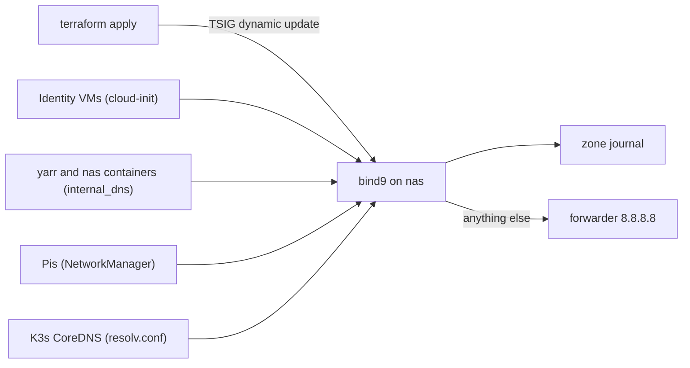

# bind9

Authoritative and recursive DNS for `example.com` on nas; Terraform writes the lab's records into it by RFC 2136 dynamic update.

| | |
|---|---|
| Host | nas |
| Address / URL | 10.0.0.225, port 53 |
| Ports | 53 (UFW application profile `bind9`) |
| Software | apt packages `bind9`, `bind9utils`, `bind9-doc`, `dnsutils` |
| Data | `/etc/bind/db.example.com` (zone file), `/var/cache/bind` (BIND working directory, holds the dynamic-update journal) |
| Deployed by | `ansible/playbooks/dns.yml`, role `bind9`; records by `terraform/proxmox/dns.tf` |
| Depends on | [proxmox.md](proxmox.md) (Terraform root module that writes the records) |
| Used by | every host that resolves `example.com`: [freeipa.md](freeipa.md), [authentik.md](authentik.md), [vaultwarden.md](vaultwarden.md), [caddy.md](caddy.md), [yarr-stack.md](yarr-stack.md), [gitea.md](gitea.md), [uptime-kuma.md](uptime-kuma.md), [../k3s.md](../k3s.md) |

## Purpose

The router does not know the internal names, so nas serves `example.com`: identity hosts, the public service names (all pointing at Caddy), FreeIPA's Kerberos and LDAP SRV records, the K3s nodes and the `*.k3s` ingress wildcard. Everything else is forwarded upstream.

## Configuration

### Files

| Path | What it sets |
|---|---|
| [`ansible/roles/bind9/tasks/main.yml`](../../ansible/roles/bind9/tasks/main.yml) | Installs packages, copies the four files below, opens UFW app `bind9` |
| [`ansible/roles/bind9/files/named`](../../ansible/roles/bind9/files/named) | Installed to `/etc/default/named`: `RESOLVCONF=no`, `OPTIONS="-u bind -4"` |
| [`ansible/roles/bind9/files/named.conf.options`](../../ansible/roles/bind9/files/named.conf.options) | Installed to `/etc/bind/named.conf.options`: recursion, query and cache queries allowed from any, `listen-on` any and `listen-on-v6` any, forwarder 8.8.8.8, `dnssec-validation auto` |
| [`ansible/roles/bind9/files/named.conf.local`](../../ansible/roles/bind9/files/named.conf.local) | Installed to `/etc/bind/named.conf.local`: primary zone `example.com` with `allow-update { key "ddnskey."; }` |
| [`ansible/roles/bind9/files/db.example.com`](../../ansible/roles/bind9/files/db.example.com) | Installed to `/etc/bind/db.example.com`: static zone (serial 5) with SOA/NS `ns1.example.com`, apex A 127.0.0.1 and AAAA ::1, `ns1` and `nas` A 10.0.0.225 |
| [`ansible/roles/bind9/handlers/main.yml`](../../ansible/roles/bind9/handlers/main.yml) | `Restart named` handler, notified when any of the four files changes |
| [`ansible/playbooks/dns.yml`](../../ansible/playbooks/dns.yml) | Applies `bind9` to `dns_servers` (nas) |
| [`terraform/proxmox/dns.tf`](../../terraform/proxmox/dns.tf), [`providers.tf`](../../terraform/proxmox/providers.tf), [`variables.tf`](../../terraform/proxmox/variables.tf) | Record definitions and the `dns` provider |
| [`ansible/roles/k3s/tasks/network.yml`](../../ansible/roles/k3s/tasks/network.yml), [`install.yml`](../../ansible/roles/k3s/tasks/install.yml) | How the Pis and K3s CoreDNS use nas |

### Variables

| Variable | Defined in | Value / meaning |
|---|---|---|
| `dns_server` | `terraform/proxmox/variables.tf` | `10.0.0.225`; where Terraform sends updates and what identity VMs use as DNS |
| `dns_zone` | `terraform/proxmox/variables.tf` | `example.com.` |
| `dns_tsig_key_algorithm` | `terraform.tfvars` | TSIG algorithm (example file: `hmac-sha256`) |
| `internal_dns_server` | `group_vars/all/main.yml` | first `dns_servers` host's `ansible_host`, i.e. 10.0.0.225 |
| `internal_dns_domain` | `group_vars/all/main.yml` | `example.com` |

### Secrets

| Vault variable | Vault file | Used for |
|---|---|---|
| `dns_tsig_key_secret` (Terraform variable, not an Ansible vault variable) | `terraform/proxmox/terraform.tfvars` (gitignored) | TSIG secret that signs Terraform's dynamic updates |

The Ansible role has no secrets. The TSIG key itself is defined on nas, outside this repo.

## How it works

nas runs BIND as primary for `example.com`. The zone file shipped by the role is minimal; the rest of the zone is written at runtime by `terraform apply` using TSIG-signed dynamic updates against `10.0.0.225`. The `dns` provider in `providers.tf` signs with the key name `rndc-key.`, while `named.conf.local` lists `ddnskey.` under `allow-update`; the live key configuration on nas is not in this repo, so check it there if updates are refused.



### Records Terraform writes

All records live in zone `example.com.` with TTL 300 (`dns.tf`).

| Resource | Name(s) | Type | Value |
|---|---|---|---|
| `dns_a_record_set.identity_host` | `freeipa` | A | 10.0.0.31 |
| | `authentik` | A | 10.0.0.32 |
| | `vaultwarden` | A | 10.0.0.33 |
| | `caddy` | A | 10.0.0.34 |
| `dns_a_record_set.service` | `auth`, `vault`, `sonarr`, `radarr`, `prowlarr`, `qbittorrent`, `gitea`, `homarr`, `uptime` | A | 10.0.0.34 (Caddy, [caddy.md](caddy.md)) |
| | `ipa-ca` | A | 10.0.0.31 (FreeIPA) |
| `dns_srv_record_set.freeipa` | `_ldap._tcp` | SRV | priority 0, weight 100, port 389, target `freeipa.example.com.` |
| | `_kerberos._tcp`, `_kerberos._udp` | SRV | port 88, same target |
| | `_kerberos-master._tcp`, `_kerberos-master._udp` | SRV | port 88, same target |
| | `_kpasswd._tcp`, `_kpasswd._udp` | SRV | port 464, same target |
| `dns_txt_record_set.kerberos_realm` | `_kerberos` | TXT | `EXAMPLE.COM` |
| `dns_a_record_set.k3s_node` | `k3s-1` to `k3s-4` | A | 10.0.0.41 to 10.0.0.44 |
| `dns_a_record_set.k3s_ingress_wildcard` | `*.k3s` | A | 10.0.0.50 (Traefik's MetalLB address) |

Static records from the zone file: `ns1` and `nas` (10.0.0.225). FreeIPA and its clients use the SRV and TXT records ([freeipa.md](freeipa.md)).

### Who uses it

- Identity VMs: through cloud-init `dns_servers` ([proxmox.md](proxmox.md)).
- yarr and nas containers: through the `internal_dns` role ([host-baseline.md](host-baseline.md)).
- The Pis: through NetworkManager (`ipv4.dns` set to the internal DNS server plus the search domain, in the k3s role's `network.yml`).
- K3s CoreDNS: through `/etc/rancher/k3s/resolv.conf`, which K3s hands to pods (`resolv-conf` in the K3s config); see [../k3s.md](../k3s.md).

## Operations

> **Warning:** Do not run `dns.yml` (or `site.yml`, which imports it) blindly. `roles/bind9/files/db.example.com` is a static zone (serial 5) with only `ns1` and `nas`, while the live zone also holds the records Terraform writes by dynamic update (`allow-update`). `dns.yml --check` shows the zone file would be replaced, and the restart could drop those records. Reconcile the file with the live zone first.

Deploy (only after reconciling):

```bash
cd ansible
ansible-playbook playbooks/dns.yml --check --diff
ansible-playbook playbooks/dns.yml
```

Write or change records:

```bash
terraform -chdir=terraform/proxmox apply
```

Verify: `dig @10.0.0.225 auth.example.com +short` returns 10.0.0.34; `dig @10.0.0.225 _ldap._tcp.example.com SRV` returns the FreeIPA target.

Recovery: if records vanish after a restart, re-run `terraform apply` to recreate them.

Known gaps:

- The shipped zone file does not contain the Terraform-written records (see the warning above).
