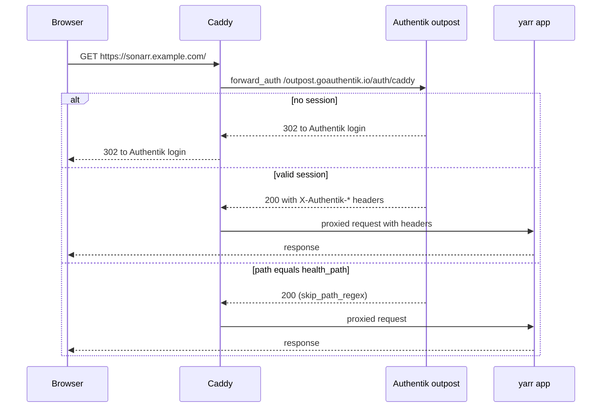

# Caddy

Reverse proxy for the lab: publishes the `*.example.com` names over HTTPS with Let's Encrypt certificates and adds Authentik forward auth in front of the yarr apps.

| | |
|---|---|
| Host | VM 304 `caddy` (identity VM, see [proxmox.md](proxmox.md)) |
| Address / URL | 10.0.0.34; all public names resolve here (see [bind9.md](bind9.md)) |
| Ports | 80/tcp, 443/tcp, 443/udp |
| Software | Local image `homelab/caddy-godaddy:local`, built from `caddy:2-builder` with xcaddy and `caddy-dns/godaddy`, on `caddy:2` |
| Data | `/opt/caddy/data` (certificates), `/opt/caddy/config` |
| Deployed by | `ansible/playbooks/identity.yml`, role `caddy` (host roles: [host-baseline.md](host-baseline.md)) |
| Depends on | [authentik.md](authentik.md), [vaultwarden.md](vaultwarden.md), [gitea.md](gitea.md), [uptime-kuma.md](uptime-kuma.md), [yarr-stack.md](yarr-stack.md) (upstreams); [bind9.md](bind9.md) (names); [freeipa.md](freeipa.md) (host enrolment) |
| Used by | [authentik.md](authentik.md), [vaultwarden.md](vaultwarden.md), [arr-apps.md](arr-apps.md), [qbittorrent-gluetun.md](qbittorrent-gluetun.md), [homarr.md](homarr.md), [gitea.md](gitea.md), [uptime-kuma.md](uptime-kuma.md) |

## Purpose

One TLS endpoint for the lab. Certificates come from DNS-01 challenges against GoDaddy, so the internal-only names still get publicly trusted certificates. For the four yarr web UIs without their own login, Caddy asks the Authentik embedded outpost to approve each request before proxying.

## Configuration

### Files

| Path | What it sets |
|---|---|
| [`ansible/roles/caddy/templates/Caddyfile.j2`](../../ansible/roles/caddy/templates/Caddyfile.j2) | The two snippets and every site block |
| [`ansible/roles/caddy/files/Dockerfile`](../../ansible/roles/caddy/files/Dockerfile) | Builds Caddy with the GoDaddy DNS module; patches `libdns/godaddy` v1.1.0 to send `Authorization: Bearer` instead of the legacy `sso-key` scheme (GoDaddy personal access tokens use Bearer) |
| [`ansible/roles/caddy/templates/docker-compose.yml.j2`](../../ansible/roles/caddy/templates/docker-compose.yml.j2) | Builds the image, publishes 80, 443 and 443/udp, mounts the Caddyfile read-only plus `data` and `config` |
| [`ansible/roles/caddy/templates/env.j2`](../../ansible/roles/caddy/templates/env.j2) | `GODADDY_API_TOKEN` |
| [`ansible/roles/caddy/defaults/main.yml`](../../ansible/roles/caddy/defaults/main.yml) | `caddy_dir` |
| [`ansible/roles/caddy/tasks/main.yml`](../../ansible/roles/caddy/tasks/main.yml), [`handlers/main.yml`](../../ansible/roles/caddy/handlers/main.yml) | Task order and the `Restart caddy` handler |
| [`ansible/inventory/group_vars/caddy_servers/main.yml`](../../ansible/inventory/group_vars/caddy_servers/main.yml) | UFW opens 22, 80 and 443 |
| [`terraform/proxmox/dns.tf`](../../terraform/proxmox/dns.tf) | DNS records that point the public names at Caddy |

### Variables

| Variable | Defined in | Value / meaning |
|---|---|---|
| `caddy_dir` | role defaults | `/opt/caddy` |
| `authentik_fqdn`, `vaultwarden_fqdn`, `homarr_fqdn`, `gitea_fqdn`, `uptime_kuma_fqdn` | `group_vars/all/main.yml` (`vaultwarden_fqdn` in `group_vars/identity/main.yml`) | Site names |
| `yarr_forward_auth_apps` | `group_vars/all/main.yml` | Per app: `slug`, `fqdn`, `port_var` (yarr group variable with the published port), `health_path`. One forward-auth site per entry |
| `authentik_http_port`, `vaultwarden_http_port` | `group_vars/identity/main.yml` | 9000, 8000 |
| `gitea_http_port`, `uptime_kuma_http_port` | `group_vars/all/main.yml` | 3000, 3001 |
| `ipa_domain` | `group_vars/all/main.yml` | `example.com`; used to build the `authentik.` upstream hostname in the forward-auth snippet |

### Secrets

| Vault variable | Vault file | Used for |
|---|---|---|
| `vault_godaddy_api_token` | `group_vars/identity/vault.yml` | `GODADDY_API_TOKEN` in `/opt/caddy/.env` (mode 0600): DNS-01 challenges |

## How it works

### Snippets

- **`(godaddy_tls)`:** `tls` with `dns godaddy {env.GODADDY_API_TOKEN}`, resolvers `1.1.1.1` and `8.8.8.8`, `propagation_delay 90s`, `propagation_timeout 10m`. The delay exists because GoDaddy publishes TXT records slowly and Let's Encrypt failed with NXDOMAIN without it.
- **`(authentik_forward_auth)`:** inside a `route`, `/outpost.goauthentik.io/*` is proxied to Authentik; then `forward_auth` sends each request to `/outpost.goauthentik.io/auth/caddy` on Authentik, copies the `X-Authentik-*` response headers onto the request, and finally the request is proxied to the upstream passed as the snippet argument.

### Sites

| Site | Upstream | Forward auth |
|---|---|---|
| `auth.example.com` | `authentik.example.com:9000` | no |
| `vault.example.com` | `vaultwarden.example.com:8000` | no |
| `sonarr.example.com` | yarr `10.0.0.160:8989` | yes |
| `radarr.example.com` | yarr `10.0.0.160:7878` | yes |
| `prowlarr.example.com` | yarr `10.0.0.160:9696` | yes |
| `qbittorrent.example.com` | yarr `10.0.0.160:8080` | yes |
| `homarr.example.com` | yarr `10.0.0.160:7575` | no (native OIDC) |
| `gitea.example.com` | nas `10.0.0.225:3000` | no (native OIDC) |
| `uptime.example.com` | nas `10.0.0.225:3001` | no (Kuma login only) |

The `auth` and `vault` upstreams are hostnames: Terraform's `dns_a_record_set.identity_host` creates `authentik`, `vaultwarden`, `caddy` and `freeipa` A records. The other upstreams are the IPs from the Ansible inventory (the yarr ports come from `group_vars/yarr`). See [arr-apps.md](arr-apps.md) and [homarr.md](homarr.md).

### DNS

`dns_a_record_set.service` in `terraform/proxmox/dns.tf` points `auth`, `vault`, `sonarr`, `radarr`, `prowlarr`, `qbittorrent`, `gitea`, `homarr` and `uptime` at Caddy's IP (VM 304). It also holds `ipa-ca`, which points at FreeIPA. Records are written to [bind9.md](bind9.md).

### Forward auth

The `health_path` bypass (`/ping` for Sonarr, Radarr and Prowlarr; `/api/v2/app/version` for qBittorrent) is configured on the Authentik proxy providers (`skip_path_regex`, see [authentik.md](authentik.md)). Uptime Kuma uses it to probe the apps through the proxy.

## Operations

- **Deploy / rebuild:** from `ansible/`, `ansible-playbook playbooks/identity.yml`. A change to the Caddyfile or `.env` triggers the `Restart caddy` handler, which is flushed before the final check.
- **First start:** Caddy needs up to ~3 minutes for Let's Encrypt certificates on first start.
- **Verify:** the role waits until `https://auth.example.com/-/health/live/` and `https://vault.example.com/alive` return 200 with valid certificates (60 tries, 10 s apart). Uptime Kuma also checks port 443 on 10.0.0.34 and each public name (see [uptime-kuma.md](uptime-kuma.md)).
- **Recovery:** certificates live in `/opt/caddy/data`.
- **`/outpost.goauthentik.io/auth/caddy` answers 404 or "no provider":** the embedded outpost has not refreshed yet; see [Rebuilding SSO](authentik.md#rebuilding-sso).
