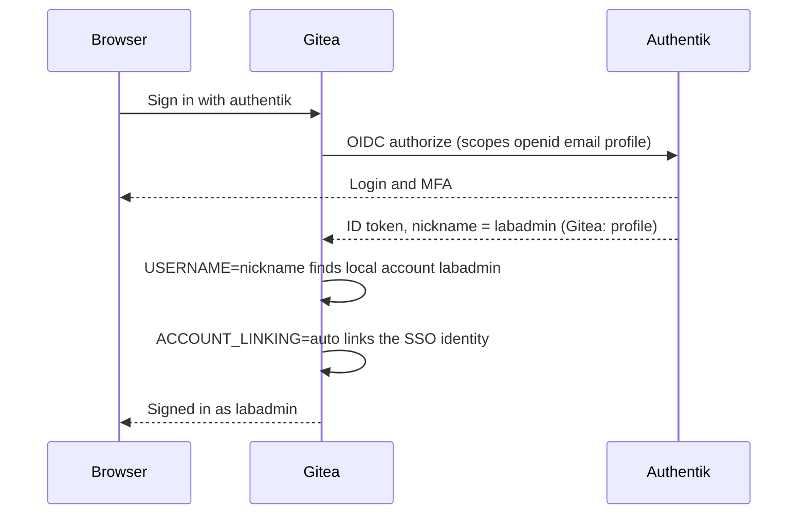

# Gitea

Git hosting on the NAS host nas, with Authentik OIDC login; it is the source Flux deploys the K3s cluster from.

| | |
|---|---|
| Host | nas |
| Address / URL | `http://10.0.0.225:3000`; `https://gitea.example.com` via [Caddy](caddy.md) |
| Ports | 3000/tcp (HTTP), 2222/tcp (SSH, container port 22) |
| Software | `docker.gitea.com/gitea:1.27.2` |
| Data | `/home/labadmin/gittea/gitea` (mounted at `/data`) |
| Deployed by | `ansible/playbooks/gitea.yml`, roles `internal_dns` and `gitea` ([host-baseline.md](host-baseline.md)) |
| Depends on | [authentik.md](authentik.md) (OIDC), [caddy.md](caddy.md) (HTTPS name), [bind9.md](bind9.md) (resolving `auth.example.com`) |
| Used by | Flux and the Gitea Actions runners in [../k3s.md](../k3s.md); [uptime-kuma.md](uptime-kuma.md) monitors it |

## Purpose

Hosts the lab's Git repositories, notably `labadmin/k3s-fleet`, which Flux syncs. Day-to-day login is SSO through Authentik; a local `labadmin` administrator is kept as break-glass.

## Configuration

### Files

| Path | What it sets |
|---|---|
| [`ansible/roles/gitea/templates/docker-compose.yml.j2`](../../ansible/roles/gitea/templates/docker-compose.yml.j2) | Container `gitea`, environment, ports, volumes |
| [`ansible/roles/gitea/tasks/main.yml`](../../ansible/roles/gitea/tasks/main.yml) | Starts the project, creates the admin, adds or updates the OIDC source |
| [`ansible/inventory/group_vars/gitea_servers/main.yml`](../../ansible/inventory/group_vars/gitea_servers/main.yml) | Directory, image, SSH port, admin user and email |
| [`ansible/playbooks/gitea.yml`](../../ansible/playbooks/gitea.yml) | Runs `internal_dns` then `gitea` on `gitea_servers` |
| [`ansible/roles/authentik/templates/blueprints/gitea.yaml.j2`](../../ansible/roles/authentik/templates/blueprints/gitea.yaml.j2) | Authentik side: the "Gitea: profile" scope mapping (see [authentik.md](authentik.md)) |
| [`ansible/roles/flux/tasks/main.yml`](../../ansible/roles/flux/tasks/main.yml), [`gitea_token.yml`](../../ansible/roles/flux/tasks/gitea_token.yml) | How the K3s bootstrap uses Gitea (see [../k3s.md](../k3s.md)) |

### Variables

| Variable | Defined in | Value / meaning |
|---|---|---|
| `gitea_dir` | `group_vars/gitea_servers` | `/home/labadmin/gittea` |
| `gitea_image` | `group_vars/gitea_servers` | `docker.gitea.com/gitea:1.27.2` |
| `gitea_ssh_port` | `group_vars/gitea_servers` | `2222` |
| `gitea_admin_user` | `group_vars/gitea_servers` | `labadmin`: local break-glass administrator, created on a fresh install |
| `gitea_admin_email` | `group_vars/gitea_servers` | Admin email address |
| `gitea_fqdn`, `gitea_http_port` | `group_vars/all/main.yml` | `gitea.example.com`, `3000` |
| `gitea_oauth_source_name` | `group_vars/all/main.yml` | `authentik` |
| `sso_admin_group` | `group_vars/all/main.yml` | `lab-admins`; passed as `--admin-group` |
| `gitea_username_map` | `group_vars/all/main.yml` | Authentik username to local Gitea username (`labuser` to `labadmin`) |

Environment in the compose file: `GITEA__server__ROOT_URL=https://gitea.example.com/` (OIDC redirect URIs are built from it), `GITEA__oauth2_client__ACCOUNT_LINKING=auto`, `ENABLE_AUTO_REGISTRATION=true`, `USERNAME=nickname`.

### Secrets

| Vault variable | Vault file | Used for |
|---|---|---|
| `vault_authentik_gitea_client_secret` | `group_vars/identity/vault.yml` | OIDC client secret (`--secret`); the role reads it from the identity vault through `hostvars` of the `authentik` host. The same value is set on the Authentik provider |

The admin password is random and never stored; see Operations for recovery.

## How it works

The compose project is named `gittea` (the spelling is real; do not "fix" it). Caddy publishes `https://gitea.example.com` and proxies to port 3000; SSH is not proxied, so Flux connects to `nas:2222` directly.

The role:

1. Renders the compose file and starts the project, then waits for `/api/v1/version`.
2. On a fresh install only, creates the administrator `gitea_admin_user` with `--random-password`.
3. Adds the OIDC source `authentik` with `gitea admin auth add-oauth`: autodiscover URL `https://auth.example.com/application/o/gitea/.well-known/openid-configuration`, key `gitea`, scopes `openid`, `email`, `profile`, group claim `groups`, `--admin-group=lab-admins`.
4. On every later run, re-applies the source with `update-oauth`, because Gitea never shows the stored secret and drift cannot be detected.

`internal_dns` runs first so the container can resolve `auth.example.com` (the router does not know internal names; see [host-baseline.md](host-baseline.md)).

### Account mapping

`gitea_username_map` maps an Authentik username to an existing local Gitea username. The `Gitea: profile` scope mapping in `blueprints/gitea.yaml.j2` returns the mapped name as `nickname`, and `ACCOUNT_LINKING=auto` links the first SSO login to the local account of that name. Members of `lab-admins` become Gitea administrators.

### Flux and runners

Flux is bootstrapped against Gitea over SSH (`--ssh-hostname=<nas>:2222`), using a token the flux role generates with `gitea admin user generate-access-token` for the `labadmin` user. The Gitea Actions runners run in K3s. Both are documented in [../k3s.md](../k3s.md).

## Operations

- **Deploy / rebuild:** from `ansible/`, `ansible-playbook playbooks/gitea.yml`. Run it after `identity.yml`, because the OIDC source needs the Authentik provider and its client secret. Repository data is in `/home/labadmin/gittea/gitea`; restore it before re-running on a rebuilt host.
- **Verify:** the role waits for `http://127.0.0.1:3000/api/v1/version`. Uptime Kuma checks `http://10.0.0.225:3000/api/healthz`, `https://gitea.example.com/api/healthz` and the SSH port 2222.
- **Recovery of the local `labadmin` password:** it is random on a fresh install; SSO is the normal login. Recover it on nas with `docker exec -u git gitea gitea admin user change-password --username labadmin --password <new>`.

Known gaps:

- Gitea's local `labadmin` password is random on a fresh install; SSO is the normal login (recovery command above).
