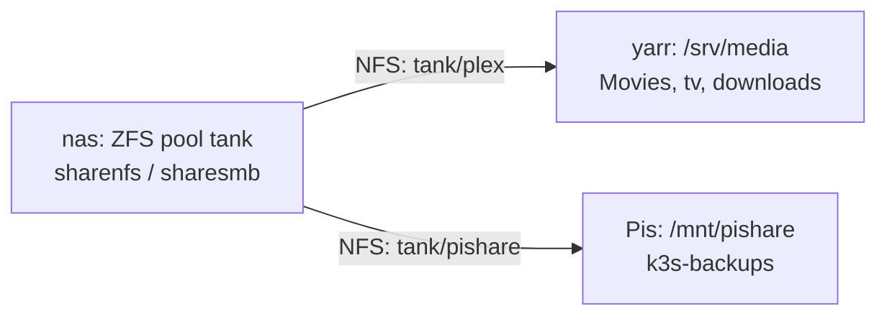

# NAS storage (nas ZFS, NFS and Samba)

The NAS (nas) shares ZFS datasets from the pool `tank` over NFS and Samba; the media host and the Raspberry Pis mount two of them. This repo does not manage the NAS.

| | |
|---|---|
| Host | nas (10.0.0.225) |
| Address / URL | `10.0.0.225:/tank/plex` and `10.0.0.225:/tank/pishare` over NFS; Samba on the same host |
| Ports | 2049 (NFS), 445 (Samba) |
| Software | ZFS pool `tank`, NFS server and Samba, set up by hand on nas (not by this repo) |
| Data | ZFS datasets under `tank`; the two the repo uses are `tank/plex` and `tank/pishare` |
| Deployed by | Not deployed by this repo. The clients are mounted by the `nfs_mount` role in `yarr.yml` and `pis.yml` |
| Depends on | Nothing in this repo |
| Used by | [yarr-stack.md](yarr-stack.md) (media on `/srv/media`), [plex.md](plex.md), [arr-apps.md](arr-apps.md), [qbittorrent-gluetun.md](qbittorrent-gluetun.md), the Pis and the K3s datastore backup in [../k3s.md](../k3s.md), [host-baseline.md](host-baseline.md) (`nfs_mount` role), [uptime-kuma.md](uptime-kuma.md) (monitors NFS and Samba) |

## Purpose

The host nas is the lab's NAS. It holds the media library that the yarr stack serves and a small share that the Raspberry Pis use for K3s datastore backups. Other containers on nas are not managed by this repo. The other services that run on nas have their own docs: [bind9.md](bind9.md), [gitea.md](gitea.md) and [uptime-kuma.md](uptime-kuma.md).

## Configuration

Shares come from the ZFS `sharenfs` and `sharesmb` properties on the datasets of pool `tank`. The repo only configures the clients.

### Files

| Path | What it sets |
|---|---|
| [`ansible/inventory/group_vars/yarr/main.yml`](../../ansible/inventory/group_vars/yarr/main.yml) | yarr mounts `10.0.0.225:/tank/plex` on `/srv/media`, with `Movies`, `tv` and `downloads` below it |
| [`ansible/inventory/group_vars/pis/main.yml`](../../ansible/inventory/group_vars/pis/main.yml) | The Pis mount `10.0.0.225:/tank/pishare` on `/mnt/pishare` |
| [`ansible/roles/nfs_mount/`](../../ansible/roles/nfs_mount/) | Installs the NFS client packages, creates the mountpoints and mounts each entry of `nfs_mounts` |
| [`ansible/inventory/group_vars/k3s_cluster/main.yml`](../../ansible/inventory/group_vars/k3s_cluster/main.yml) | `backup_dest: /mnt/pishare/k3s-backups` |
| [`ansible/inventory/group_vars/uptime_kuma_servers/main.yml`](../../ansible/inventory/group_vars/uptime_kuma_servers/main.yml) | Uptime Kuma port checks for 2049 and 445 |

### Variables

| Variable | Defined in | Value / meaning |
|---|---|---|
| `nfs_mounts` | `group_vars/yarr/main.yml` | One entry: `10.0.0.225:/tank/plex` on `/srv/media` |
| `nfs_mount_opts` | `group_vars/yarr/main.yml` | `defaults,_netdev,nofail,x-systemd.automount,x-systemd.requires=network-online.target` |
| `media_root`, `media_movies_path`, `media_tv_path`, `media_downloads_path` | `group_vars/yarr/main.yml` | `/srv/media`, `/srv/media/Movies`, `/srv/media/tv`, `/srv/media/downloads` |
| `nfs_mounts` | `group_vars/pis/main.yml` | One entry: `10.0.0.225:/tank/pishare` on `/mnt/pishare`, options `rw,sync`, mode `0777`, owner and group `root` |
| `nfs_mount_packages` | `group_vars/pis/main.yml` | `nfs-common`, `nfs4-acl-tools` (the role default is `nfs-common` only) |
| `backup_dest` | `group_vars/k3s_cluster/main.yml` | `/mnt/pishare/k3s-backups` |
| `backup_keep` | `roles/backup/defaults/main.yml` | `14` |

### Secrets

None.

### Manual steps

The shares are set up by hand on nas; no playbook or Terraform module does it. Each shared dataset has the ZFS `sharenfs` and, where it is also a Samba share, `sharesmb` property set on pool `tank`.

Shares the repo consumes:

| Dataset | Protocol | Mounted on | Holds |
|---|---|---|---|
| `tank/plex` | NFS and SMB | yarr, `/srv/media` | `Movies`, `tv`, `downloads` |
| `tank/pishare` | NFS | the Pis, `/mnt/pishare` | `k3s-backups` |

This doc does not list the other datasets as facts, because they can change on nas without a repo change. To see what nas shares now:

```bash
ssh labadmin@10.0.0.225 "zfs get -H -o name,property,value sharenfs,sharesmb -t filesystem | grep -v off$"
ssh labadmin@10.0.0.225 testparm -s
```

On 2026-11-01 these showed NFS on `home-lab`, `logs`, `photography`, `pishare`, `plex`, `pool`, `roms` and `workspace`, and Samba sections `plex`, `pool` (`/share`), `roms` and `workspace`.

## How it works



- On yarr the `nfs_mount` role mounts `tank/plex` on `/srv/media` with `x-systemd.automount`, so the mount happens on first access and a missing NAS does not block boot (`nofail`, `_netdev`). The compose file bind-mounts `Movies`, `tv` and `downloads` into Plex, `tv` and `downloads` into Sonarr, `Movies` and `downloads` into Radarr, and `downloads` into qBittorrent, see [yarr-stack.md](yarr-stack.md).
- On the Pis `pis.yml` runs `nfs_mount` after its pre-tasks, mounting `tank/pishare` on `/mnt/pishare` with `rw,sync`. The K3s backup role refuses to run when `/mnt/pishare` is not a mountpoint, and writes the nightly age-encrypted datastore backups to `/mnt/pishare/k3s-backups`, keeping 14 (`backup_keep`). See [../k3s.md](../k3s.md).
- The mounts use the IP `10.0.0.225`, so they do not depend on DNS. The shared role is described in [host-baseline.md](host-baseline.md).
- Uptime Kuma checks TCP 2049 (NFS) and 445 (Samba) on nas, see [uptime-kuma.md](uptime-kuma.md).

## Operations

### Deploy

The NAS is not deployed from this repo. To (re)mount the clients, from `ansible/`:

```bash
ansible-playbook playbooks/yarr.yml   # yarr: /srv/media
ansible-playbook playbooks/pis.yml    # Pis: /mnt/pishare
```

### Verify

- Run the inspection commands under [Manual steps](#manual-steps) to see what nas shares.
- On a client, `mountpoint /srv/media` (yarr) or `mountpoint /mnt/pishare` (Pis) succeeds.
- Uptime Kuma's NFS and Samba monitors are up.

### Recovery

If a client lost its mount, rerun the playbook above. If nas lost a share, the repo cannot restore it: set the `sharenfs` and `sharesmb` properties on the dataset again on nas.

### Known gaps

- The shares exist only as ZFS properties on nas; nothing in this repo records or recreates them.
- On 2026-11-01 the ZFS properties also showed `sharesmb=on` for `home-lab` and `photography`, which had no Samba section in the `testparm -s` output.
