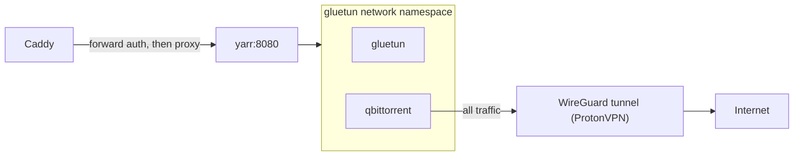

# qBittorrent and Gluetun

qBittorrent is the torrent client; it shares Gluetun's network namespace so all its traffic leaves through a ProtonVPN WireGuard tunnel.

| | |
|---|---|
| Host | yarr VM 107 (10.0.0.160), see [yarr-stack.md](yarr-stack.md) |
| Address / URL | `https://qbittorrent.example.com` |
| Ports | 8080 (Web UI) and 6881 tcp/udp, published by the gluetun container |
| Software | `lscr.io/linuxserver/qbittorrent:latest`, `qmcgaw/gluetun:latest` |
| Data | `/opt/yarr/config/qbittorrent`, `/opt/yarr/config/gluetun`; downloads on `/srv/media/downloads` (NFS) |
| Deployed by | `ansible/playbooks/yarr.yml`, role `yarr_stack` |
| Depends on | [yarr-stack.md](yarr-stack.md), [nas-storage.md](nas-storage.md), [caddy.md](caddy.md), [authentik.md](authentik.md) |
| Used by | [arr-apps.md](arr-apps.md) (download client), [uptime-kuma.md](uptime-kuma.md) |

## Purpose

Download torrents for Sonarr and Radarr without exposing the host's IP: qBittorrent has no network of its own, only the VPN tunnel.

## Configuration

### Files

| Path | What it sets |
|---|---|
| [`yarr_stack/templates/docker-compose.yml.j2`](../../ansible/roles/yarr_stack/templates/docker-compose.yml.j2) | gluetun and qbittorrent services, ports, `network_mode` |
| [`yarr_stack/templates/env.j2`](../../ansible/roles/yarr_stack/templates/env.j2) | VPN settings and credentials written to `/opt/yarr/.env` |
| [`yarr_stack/tasks/main.yml`](../../ansible/roles/yarr_stack/tasks/main.yml) | qBittorrent password and auth-bypass tasks |
| [`yarr_stack/defaults/main.yml`](../../ansible/roles/yarr_stack/defaults/main.yml) | Login-success and session-cookie helper facts |
| [`inventory/group_vars/yarr/main.yml`](../../ansible/inventory/group_vars/yarr/main.yml) | Gluetun and qBittorrent variables |

### Variables

| Variable | Defined in | Value / meaning |
|---|---|---|
| `gluetun_enabled` | `group_vars/yarr/main.yml` | `true`. When false, qBittorrent publishes its own ports instead of using the tunnel |
| `gluetun_vpn_service_provider` | `group_vars/yarr/main.yml` | `protonvpn` |
| `gluetun_vpn_type` | `group_vars/yarr/main.yml` | `wireguard` |
| `gluetun_server_countries` | `group_vars/yarr/main.yml` | `United States` |
| `qbittorrent_webui_port` | `group_vars/yarr/main.yml` | 8080 |
| `yarr_sso_proxy_ip` | `group_vars/yarr/main.yml` | Caddy's IP; whitelisted for login bypass as `<ip>/32` |

### Secrets

All in `group_vars/yarr/vault.yml`. The `.env` key mapping is in [yarr-stack.md](yarr-stack.md).

| Vault variable | Vault file | Used for |
|---|---|---|
| `vault_gluetun_wireguard_private_key` | `group_vars/yarr/vault.yml` | WireGuard private key |
| `vault_gluetun_wireguard_addresses` | `group_vars/yarr/vault.yml` | WireGuard interface address |
| `vault_gluetun_openvpn_user` | `group_vars/yarr/vault.yml` | OpenVPN user (defaults to empty if unset) |
| `vault_gluetun_openvpn_password` | `group_vars/yarr/vault.yml` | OpenVPN password (defaults to empty if unset) |
| `vault_qbittorrent_webui_password` | `group_vars/yarr/vault.yml` | qBittorrent `admin` Web UI password |

## How it works

qBittorrent runs through Gluetun (ProtonVPN, WireGuard).

Gluetun runs with `NET_ADMIN` and `/dev/net/tun` and publishes the qBittorrent Web UI (8080) and the torrent port (6881 tcp/udp). With `gluetun_enabled`, qBittorrent uses `network_mode: service:gluetun` and `depends_on: gluetun`, so every packet it sends leaves through the VPN tunnel.

**Password tasks** (tag `qbittorrent_password`), run after the stack is up:

1. Wait for the Web UI (`/api/v2/app/version` answers 200 or 403).
2. Log in as `admin` with `vault_qbittorrent_webui_password`.
3. If that fails, scrape the temporary password from `docker logs qbittorrent`, log in with it and set the vault password through `setPreferences`.
4. Read the preferences and, if needed, set `bypass_auth_subnet_whitelist` to `<caddy IP>/32` with the whitelist enabled. Authentik is therefore the only login through Caddy.

**Health checks:** `/api/v2/app/version` is the Authentik skip path (`yarr_forward_auth_apps`), so Uptime Kuma can probe it. Gluetun has no web endpoint; its Docker health is pushed to Uptime Kuma by the `kuma-push` timer ([uptime-kuma.md](uptime-kuma.md)).

## Operations

Deploy: `cd ansible && ansible-playbook playbooks/yarr.yml` (dry-run notes are in [yarr-stack.md](yarr-stack.md)).

Verify: `docker ps` on yarr shows `gluetun` healthy and `qbittorrent` running; `https://qbittorrent.example.com` redirects to Authentik.

Recovery: if the tunnel is down, check the Gluetun logs (`docker logs gluetun`) and the WireGuard credentials. qBittorrent has no route out without the tunnel. Re-run the playbook to reset the Web UI password and the Caddy bypass whitelist.

Known gaps: see the forward-auth note for API clients in [arr-apps.md](arr-apps.md).
