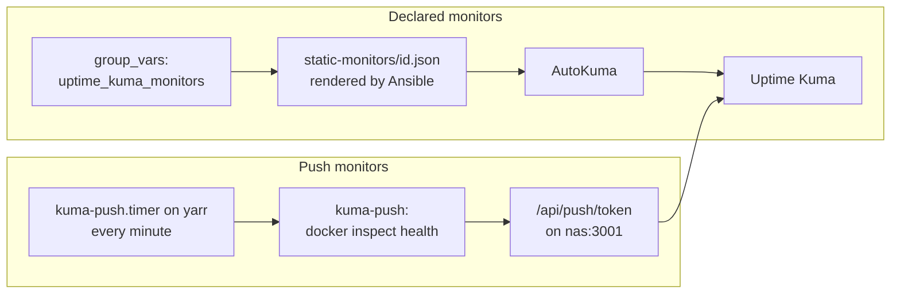

# Uptime Kuma

Uptime Kuma with AutoKuma on nas gives up/down checks for the lab services; every monitor is declared in Ansible and created by AutoKuma.

| | |
|---|---|
| Host | nas (10.0.0.225) |
| Address / URL | `http://10.0.0.225:3001`, `https://uptime.example.com` (through [Caddy](caddy.md)) |
| Ports | 3001 (`uptime_kuma_http_port`, published on the host) |
| Software | `louislam/uptime-kuma:2.5.9-slim` (`UPTIME_KUMA_DB_TYPE=sqlite`), `ghcr.io/bigboot/autokuma:2.0.0` |
| Data | `/opt/uptime-kuma/data` (Kuma database and history), `/opt/uptime-kuma/autokuma-data`, `/opt/uptime-kuma/static-monitors` |
| Deployed by | `ansible/playbooks/uptime_kuma.yml` (role `uptime_kuma`); push timer from `yarr.yml` (role `yarr_stack`) |
| Depends on | [caddy.md](caddy.md) and [bind9.md](bind9.md) (for the `uptime.example.com` name), [yarr-stack.md](yarr-stack.md) (push timer) |
| Used by | Observes every lab service, see [Monitor groups](#monitor-groups): [proxmox.md](proxmox.md), [freeipa.md](freeipa.md), [authentik.md](authentik.md), [vaultwarden.md](vaultwarden.md), [caddy.md](caddy.md), [bind9.md](bind9.md), [nas-storage.md](nas-storage.md), [gitea.md](gitea.md), [plex.md](plex.md), [arr-apps.md](arr-apps.md), [qbittorrent-gluetun.md](qbittorrent-gluetun.md), [homarr.md](homarr.md), [yarr-stack.md](yarr-stack.md), [../k3s.md](../k3s.md) |

## Purpose

Uptime Kuma shows whether each lab service is up. AutoKuma creates and deletes the monitors from JSON files that Ansible renders from `uptime_kuma_monitors`, so no monitor is created by hand and a rebuild needs no UI step. No notifications are configured.

`https://uptime.example.com` is served by Caddy with no forward auth (Kuma login only), so the dashboard keeps working during an SSO outage.

## Configuration

### Files

| Path | What it sets |
|---|---|
| [`ansible/roles/uptime_kuma/tasks/main.yml`](../../ansible/roles/uptime_kuma/tasks/main.yml) | Directories, `.env`, compose file, static monitor JSON files, removal of stale ones, compose up, readiness wait, admin creation |
| [`ansible/roles/uptime_kuma/defaults/main.yml`](../../ansible/roles/uptime_kuma/defaults/main.yml) | Install directory, image tags, admin user, monitor defaults |
| [`ansible/roles/uptime_kuma/templates/docker-compose.yml.j2`](../../ansible/roles/uptime_kuma/templates/docker-compose.yml.j2) | Compose project `uptime-kuma`: the `uptime-kuma` and `autokuma` containers |
| [`ansible/roles/uptime_kuma/templates/env.j2`](../../ansible/roles/uptime_kuma/templates/env.j2) | `/opt/uptime-kuma/.env` (mode 0600): AutoKuma's Kuma username and password |
| [`ansible/roles/uptime_kuma/files/uptime-kuma-setup-admin.js`](../../ansible/roles/uptime_kuma/files/uptime-kuma-setup-admin.js) | Creates the first Kuma user through the socket.io `setup` event |
| [`ansible/inventory/group_vars/uptime_kuma_servers/main.yml`](../../ansible/inventory/group_vars/uptime_kuma_servers/main.yml) | `uptime_kuma_monitors`: every monitor, and the list of what is deliberately not monitored |
| [`ansible/roles/yarr_stack/tasks/kuma_push.yml`](../../ansible/roles/yarr_stack/tasks/kuma_push.yml) | Installs the push script, service and timer on yarr |
| [`ansible/roles/yarr_stack/templates/kuma-push.sh.j2`](../../ansible/roles/yarr_stack/templates/kuma-push.sh.j2) | `/usr/local/sbin/kuma-push` (mode 0700) |
| [`ansible/roles/yarr_stack/files/kuma-push.service`](../../ansible/roles/yarr_stack/files/kuma-push.service), [`kuma-push.timer`](../../ansible/roles/yarr_stack/files/kuma-push.timer) | systemd oneshot service and a timer that fires every minute |
| [`ansible/inventory/group_vars/yarr/main.yml`](../../ansible/inventory/group_vars/yarr/main.yml) | `yarr_kuma_push_containers` |
| [`ansible/inventory/group_vars/uptime_kuma_servers/vault.yml`](../../ansible/inventory/group_vars/uptime_kuma_servers/vault.yml) | Encrypted: admin password and push tokens |

The compose file runs AutoKuma with the Docker source off (`AUTOKUMA__DOCKER__ENABLED=false`), `static-monitors` mounted read-only, and `AUTOKUMA__ON_DELETE=delete`.

### Variables

| Variable | Defined in | Value / meaning |
|---|---|---|
| `uptime_kuma_dir` | role defaults | `/opt/uptime-kuma` |
| `uptime_kuma_tag` | role defaults | `2.5.9-slim` |
| `autokuma_tag` | role defaults | `2.0.0` |
| `uptime_kuma_admin_user` | role defaults | `{{ admin_user }}` (`labadmin`) |
| `uptime_kuma_monitor_defaults` | role defaults | `{ interval: 60, retry_interval: 30, max_retries: 2 }`, applied to every non-group monitor; per-monitor keys win |
| `uptime_kuma_http_defaults` | role defaults | `{ max_redirects: 0 }` for `http` and `keyword` monitors: a forward-auth 302 to Authentik must not count as up |
| `uptime_kuma_http_port` | `group_vars/all/main.yml` | `3001` |
| `uptime_kuma_fqdn` | `group_vars/all/main.yml` | `uptime.example.com` |
| `uptime_kuma_monitors` | `group_vars/uptime_kuma_servers/main.yml` | The monitor list; `parent_name` is the `id` of a group item |
| `yarr_kuma_push_containers` | `group_vars/yarr/main.yml` | Containers whose Docker health is pushed: `gluetun` and `watchtower`, each with its `token_var` |

### Secrets

All three live in `ansible/inventory/group_vars/uptime_kuma_servers/vault.yml`.

| Vault variable | Vault file | Used for |
|---|---|---|
| `vault_uptime_kuma_admin_password` | `group_vars/uptime_kuma_servers/vault.yml` | The Kuma admin password; also AutoKuma's login in `.env` |
| `vault_uptime_kuma_push_token_gluetun` | `group_vars/uptime_kuma_servers/vault.yml` | Push token of the Gluetun monitor, and the token `kuma-push` sends for the `gluetun` container |
| `vault_uptime_kuma_push_token_watchtower` | `group_vars/uptime_kuma_servers/vault.yml` | Push token of the Watchtower monitor, and the token `kuma-push` sends for the `watchtower` container |

Each push token is 32 hex characters, made with `scripts/vault-add-secret.sh <file> <var> 16` (the script refuses to overwrite an existing variable). Add one per container pushed from yarr.

## How it works



**Monitors.** Ansible renders each `uptime_kuma_monitors` item to `static-monitors/<id>.json`, merging `uptime_kuma_monitor_defaults` (non-group items), `uptime_kuma_http_defaults` (`http` and `keyword` items) and the item's own keys. Files for monitors that are no longer defined are removed, and AutoKuma then deletes those monitors from Kuma. Editing a monitor in the file changes it in Kuma.

**Admin.** Kuma has no environment variable or REST endpoint for the first user. `uptime-kuma-setup-admin.js` runs inside the container (`docker exec -i uptime-kuma node -`) and uses the socket.io `needSetup` and `setup` events. It prints `changed` or `unchanged`; exit code 3 means Kuma is not accepting connections yet, and the task retries.

**Authentik bypass.** Sonarr, Radarr, Prowlarr and qBittorrent sit behind Authentik forward auth. Only each app's `health_path` (`yarr_forward_auth_apps`) is let through without login by an anchored `skip_path_regex`, and that path is what Kuma probes (`/ping`, and `/api/v2/app/version` for qBittorrent). See [caddy.md](caddy.md) and [authentik.md](authentik.md).

**Push monitors.** Gluetun and Watchtower have no web endpoint. The `kuma-push.timer` on yarr starts `kuma-push` one minute after boot and then every minute. For each container in `yarr_kuma_push_containers` the script reads its Docker health status (or its state if it has no health check; a missing container counts as down) and calls `http://10.0.0.225:3001/api/push/<token>?status=up|down&msg=<state>`. A container reports `up` only when it is `healthy`. Both push monitors have `interval: 120` and `max_retries: 1`.

### Monitor groups

36 monitors in 5 groups. URLs and ports are in [`group_vars/uptime_kuma_servers/main.yml`](../../ansible/inventory/group_vars/uptime_kuma_servers/main.yml).

| Group | Monitors | Count |
|---|---|---|
| Hosts | Ping checks: pve1 (Proxmox), freeipa (VM 301), authentik (VM 302), vaultwarden (VM 303), caddy (VM 304), yarr (VM 107), k3s-1 to k3s-4 | 10 |
| Identity & edge | FreeIPA web UI, FreeIPA LDAPS (636), FreeIPA Kerberos (88), Authentik direct and via `auth.example.com`, Vaultwarden direct and via `vault.example.com`, Caddy HTTPS listener (443) | 8 |
| NAS (nas) | bind9 (DNS lookup of `auth.example.com` against nas), NFS (2049), Samba (445), Gitea direct and via `gitea.example.com`, Gitea SSH (2222) | 6 |
| Media (yarr) | Plex, Sonarr, Radarr, Prowlarr, qBittorrent, Homarr, FlareSolverr (keyword "FlareSolverr is ready"), Gluetun (push), Watchtower (push) | 9 |
| Proxmox & K3s | Proxmox web/API, K3s API server (TCP 6443; `/readyz` answers 401 anonymously), K3s ingress (Traefik to podinfo) | 3 |

The FreeIPA and Proxmox web checks use `ignore_tls: true` (the IPA CA is not in Kuma's trust store). The K3s ingress check probes MetalLB and Traefik through the podinfo demo app, so repoint it if podinfo is removed.

### Deliberately not monitored

- nas and Kuma itself: they cannot observe their own outage.
- Stopped VMs (100-106, 108-110, LXC 105).
- Flux, VictoriaMetrics, Gitea runners: no network endpoint; cluster metrics belong to VictoriaMetrics.

### Observed behavior

From the 2026-11-01 deployment on Kuma 2.5.9:

- Monitors carry no `AutoKuma` tag.
- `/metrics` keeps stale series for monitors AutoKuma edited after creating them, and group monitors can show status 2 there.

## Operations

### Rebuilding Uptime Kuma

Declarative; no UI step. Secrets in `inventory/group_vars/uptime_kuma_servers/vault.yml`: `vault_uptime_kuma_admin_password` and one 32-hex-char push token per container pushed from yarr (`scripts/vault-add-secret.sh <file> <var> 16`). Add the DNS record (`uptime`), run `identity.yml --limit caddy` for the site, then `uptime_kuma.yml` on nas (creates the admin through the socket.io `setup` event, AutoKuma syncs `static-monitors/*.json`) and `yarr.yml` for the push timer. Kuma history lives in `/opt/uptime-kuma/data`; back it up if you want it kept. Add or remove monitors by editing `uptime_kuma_monitors` and rerunning `uptime_kuma.yml`; removed items are deleted in Kuma.

### Deploy

From `ansible/`:

```bash
ansible-playbook playbooks/uptime_kuma.yml   # Kuma admin + AutoKuma monitors; run after yarr.yml pushes start reporting
```

The play waits for `http://127.0.0.1:3001/api/entry-page` to return 200 (up to 30 tries, 5 seconds apart) before it creates the admin.

### Verify

- `curl -s -o /dev/null -w '%{http_code}\n' http://10.0.0.225:3001/api/entry-page` returns `200`.
- `ssh labadmin@10.0.0.225 'docker ps --format "{{.Names}} {{.Image}}"'` lists `uptime-kuma` (`louislam/uptime-kuma:2.5.9-slim`) and `autokuma` (`ghcr.io/bigboot/autokuma:2.0.0`); this matched the code on 2026-11-01.
- Push monitors are green only while `kuma-push.timer` runs on yarr (`systemctl list-timers kuma-push.timer`).

### Recovery

- Kuma history lives in `/opt/uptime-kuma/data`; restore that directory to keep it. Without it a rebuild starts with an empty history and the same monitors.
- A monitor removed from `uptime_kuma_monitors` is deleted in Kuma by AutoKuma. To drop a monitor, delete its item and rerun the playbook.

### Known gaps

- No notification channel is configured; a failing monitor changes the dashboard only.
- nas and Kuma itself are not monitored, see [Deliberately not monitored](#deliberately-not-monitored).
